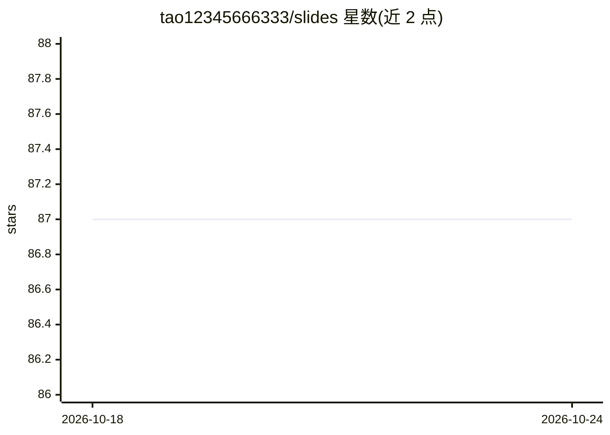

# tao12345666333/slides

⭐ 87 · Apache-2.0 · 推送 2026-04-18 · [GitHub](https://github.com/tao12345666333/slides) · 个人维护 · 中文 README

**个人公开 slides 内容存档仓库（技术分享幻灯片）**

个人维护的幻灯片内容归档仓库，README 仅说明这里存放可公开的 slides 内容且非全部。根据仓库主题标签，内容涉及 AI、LLM、Kubernetes、Kong、Docker、Node.js、Python 等技术领域。仓库为内容存档性质，无安装、运行或使用说明，README 未提供任何代码功能描述。

## 筛选速览

| 维度 | 判定 | 备注 |
|---|---|---|
| AI 角色 | `ai-knowledge` | 知识聚合/清单类 |
| 许可风险 | `permissive` | Apache-2.0 |
| 部署形态 | `None` |  |
| 模型依赖 | — | README 未给出锁定关系 |
| 硬件要求 | — | 无带数字的原话,不猜 |
| 安装摩擦 | `low` | 无编译、无系统依赖或容器化 |
| 成熟度 | — | 结构信号不足 |

## 能力要点

- 存放可公开的个人 slides 内容
- 主题标签覆盖 AI/LLM/Kubernetes/Docker 等技术领域

## 适用场景

- 查阅作者在各技术大会或社区分享的幻灯片内容

## 场景标签

`教程课程` · 领域:学习与行业

## 证据(README 行号)

> L3: 这里记录着我的一些可公开的 slides 内容。非全部。

## 星数曲线

2026-10-18 87 → 2026-10-24 87（+0）

---
*卡片 v1 · prompt 1.4 · 生成 2026-10-23 · 置信度 low · 依据 README sha `1acabfc6ff02` · [字段定义](../../DATASET.md)*
