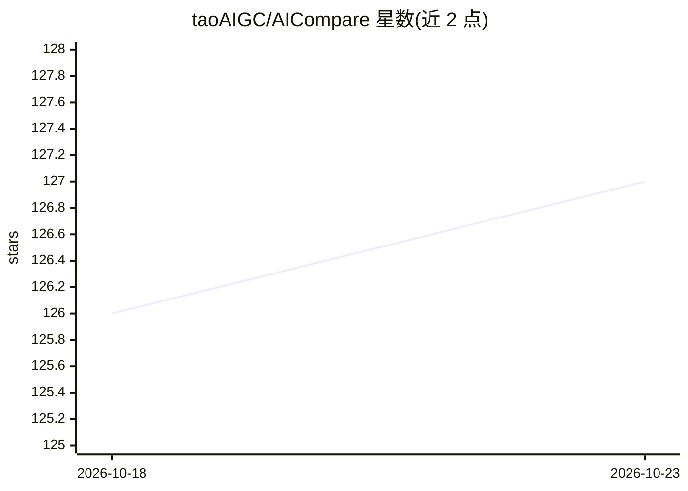

# taoAIGC/AICompare

⭐ 127 · JavaScript · GPL-3.0 · 推送 2026-10-12 · [GitHub](https://github.com/taoAIGC/AICompare) · 个人维护 · 中文 README

**一键在多标签内打开多个 AI 站点并排对比回答的浏览器扩展**

Chrome/Edge 浏览器扩展（原名 AI Shortcuts）：在单页内以 iframe 嵌入多个 AI 站点（ChatGPT、Gemini、Claude、Grok、DeepSeek、Kimi、豆包、元宝等），一次输入同时向所选站点发送查询并查看结果；使用用户已有账号，无需注册。附带侧边栏、划词工具栏、搜索引擎工具栏、右键菜单、omnibox、历史与收藏、WebDAV/Google Drive 云同步，以及扫码配对的手机远程搜索 v1（端到端加密 WebSocket 中继）。站点列表由 siteHandlers.json 配置。

## 筛选速览

| 维度 | 判定 | 备注 |
|---|---|---|
| AI 角色 | `ai-ecosystem` | LLM/agent 周边工具 |
| 许可风险 | `viral` | GPL-3.0 |
| 部署形态 | `library` | 以包/库形式分发 |
| 模型依赖 | — | README 未给出锁定关系 |
| 硬件要求 | — | 无带数字的原话,不猜 |
| 安装摩擦 | `low` | 无编译、无系统依赖或容器化 |
| 成熟度 | — | 结构信号不足 |

## 能力要点

- 单页 iframe 嵌入多个 AI 站点，一次查询多站发送
- 划词/搜索引擎/右键/地址栏多入口触发多站对比
- WebDAV 与 Google Drive 云同步设置，本地 JSON 备份
- Remote Search v1：手机扫码远程发起对比查询（端到端加密中继）

## 适用场景

- 写一条提示词同时发给多个 AI 站点，并排比较回答
- 在搜索引擎或任意网页划选文本后直接发起多站查询
- 收藏常用查询模板与站点组合，快速重复对比

## 场景标签

`模型评测` · 领域:评测与运维

## 证据(README 行号)

> L9: **AI Compare** (formerly "AI Shortcuts") is a browser extension that lets you compare answers from multiple AI model
> L15: - **One page, multiple AIs**: Open a single tab with several AI sites embedded (iframes). Enter your query once and

## 星数曲线

2026-10-18 126 → 2026-10-23 127（+1）

---
*卡片 v1 · prompt 1.4 · 生成 2026-10-23 · 置信度 mid · 依据 README sha `6fc64b896601` · [字段定义](../../DATASET.md)*
