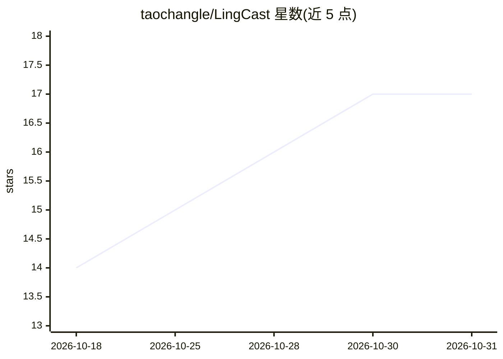

# taochangle/LingCast

⭐ 17 · TypeScript · 推送 2026-10-30 · [GitHub](https://github.com/taochangle/LingCast) · [官网](https://taochangle.github.io/LingCast/) · 个人维护 · 中文 README

**端到端 AI 数字人直播平台：形象生成、口型同步与 LLM 实时互动**

LingCast 是一套 AI 数字人直播平台：用图片、Edge-TTS 声音与人设档案创建数字人，LivePortrait 生成基础视频，Edge-TTS 合成语音后经 Wav2Lip（ONNX）做口型同步，DeepSeek LLM 生成实时回复，最终通过 SRS 推流，配套 Next.js 观众端直播间（弹幕、分类、游客/账号身份）。平台还提供场景视频库、本地 RAG 知识库（零模型依赖、Jieba 分词 + zvec 全文检索）、GFPGAN/CodeFormer 人脸修复、24fps watchdog 推流管线、Telegram Mini App 登录与中英双语 UI。基础设施用 Docker Compose 一键启动，AI Worker 原生运行于宿主机（macOS MPS / Linux CUDA / AMD ROCm）；直播推理（Edge-TTS + Wav2Lip ONNX）可无 GPU 运行。

## 筛选速览

| 维度 | 判定 | 备注 |
|---|---|---|
| AI 角色 | `ai-native` | 本体是模型或模型工具 |
| 许可风险 | `none` | — |
| 部署形态 | `self-host` | docker 或自建部署 |
| 模型依赖 | locked-api |  |
| 硬件要求 | — | 无带数字的原话,不猜 |
| 安装摩擦 | `low` | 无编译、无系统依赖或容器化 |
| 成熟度 | — | 结构信号不足 |

## 能力要点

- LivePortrait 基础视频 + Edge-TTS + Wav2Lip ONNX 口型同步的直播管线
- DeepSeek LLM 实时回复观众消息，人设档案注入 system prompt
- 本地 RAG 知识库：无 sentence-transformers/torch，Jieba 分词 + zvec 全文检索，Top-3 chunks 注入提示词
- GFPGANv1.4/CodeFormer ONNX 人脸修复与 24fps watchdog 无卡顿推流

## 适用场景

- 我想搭一个 7x24 无人值守的 AI 数字人直播间并与观众实时对话
- 给数字人绑定私有知识库，让直播回复基于自己的资料
- 让观众通过网页或 Telegram Mini App 观看并和数字人聊天

## 场景标签

`语音合成` `RAG` `聊天机器人` · 领域:对话与助手

## 证据(README 行号)

> L7: End-to-end AI digital-human live-streaming platform: create a digital human (appearance +
> L95: - [x] **LLM replies**: viewer messages → OpenAI Go SDK calls the DeepSeek Responses API
> L101: - [x] **Edge-TTS speech synthesis**: GPU-free cloud neural voices, selected by the avatar's

## 星数曲线

2026-10-18 14 → 2026-10-31 17（+3）

---
*卡片 v1 · prompt 1.4 · 生成 2026-10-30 · 置信度 mid · 依据 README sha `e1d9e3ba8a2b` · [字段定义](../../DATASET.md)*
