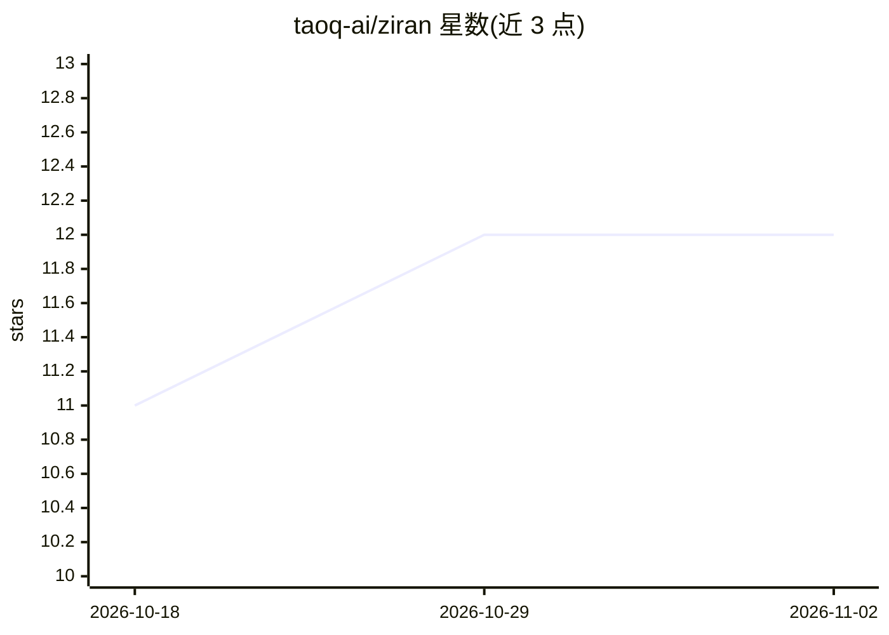

# taoq-ai/ziran

⭐ 12 · Python · Apache-2.0 · 推送 2026-10-29 · [GitHub](https://github.com/taoq-ai/ziran) · [官网](https://taoq-ai.github.io/ziran/) · 组织维护

**AI agent 安全测试工具：图式工具链漏洞发现与多阶段攻击验证**

面向安全测试人员与 agent 开发者的 Python 工具与 CLI，检测由多工具组合产生的 AI agent 漏洞（如 read_file→http_request 数据外泄链）而非单条 prompt 问题。五阶段流水线（discover/map/analyze/attack/report），基于 NetworkX 图匹配 30+ 危险链模式，支持静态审计（无需 LLM/API key）与对远程 HTTPS agent 的 8 阶段攻击战役；在执行层拦截工具调用检测副作用。兼容 LangChain、CrewAI、MCP、A2A 与 Claude Code agent，输出 HTML/Markdown/JSON/SARIF 报告并可作 CI 质量门禁。明确声明不是 LLM 对齐工具、运行时护栏或通用评测框架。

## 筛选速览

| 维度 | 判定 | 备注 |
|---|---|---|
| AI 角色 | `ai-ecosystem` | LLM/agent 周边工具 |
| 许可风险 | `permissive` | Apache-2.0 |
| 部署形态 | `self-host` | docker 或自建部署 |
| 模型依赖 | — | README 未给出锁定关系 |
| 硬件要求 | — | 无带数字的原话,不猜 |
| 安装摩擦 | `low` | 无编译、无系统依赖或容器化 |
| 成熟度 | — | 结构信号不足 |

## 能力要点

- 图式工具链发现：映射能力到 NetworkX 图并匹配 30+ 危险链模式
- 8 阶段攻击战役（侦察到外泄），图反馈自适应选择阶段
- 执行层副作用检测：拦截工具调用而非聊天回复
- 639 个攻击向量，覆盖 OWASP LLM Top 10 与 72/86 MITRE ATLAS 技术

## 适用场景

- 部署前审计 Claude Code / LangChain / CrewAI agent 的组合工具漏洞
- 对线上 HTTPS agent 执行自动化渗透测试
- 在 CI 中作为安全质量门禁并输出 SARIF

## 场景标签

`网络安全` · 领域:学习与行业

## 证据(README 行号)

> L32: **What just happened.** ZIRAN mapped each declared tool to a capability (`Read` is `read_file`, `WebFetch` is `http
> L49: Five stages. **DISCOVER** probes tools, permissions and data access. **MAP** builds a NetworkX graph of capabilitie
> L77: **ZIRAN is not** an LLM safety or alignment tool (use Promptfoo or Garak for jailbreak breadth and compliance), not

## 星数曲线

2026-10-18 11 → 2026-11-02 12（+1）

---
*卡片 v1 · prompt 1.4 · 生成 2026-10-31 · 置信度 high · 依据 README sha `f7b2c626452e` · [字段定义](../../DATASET.md)*
