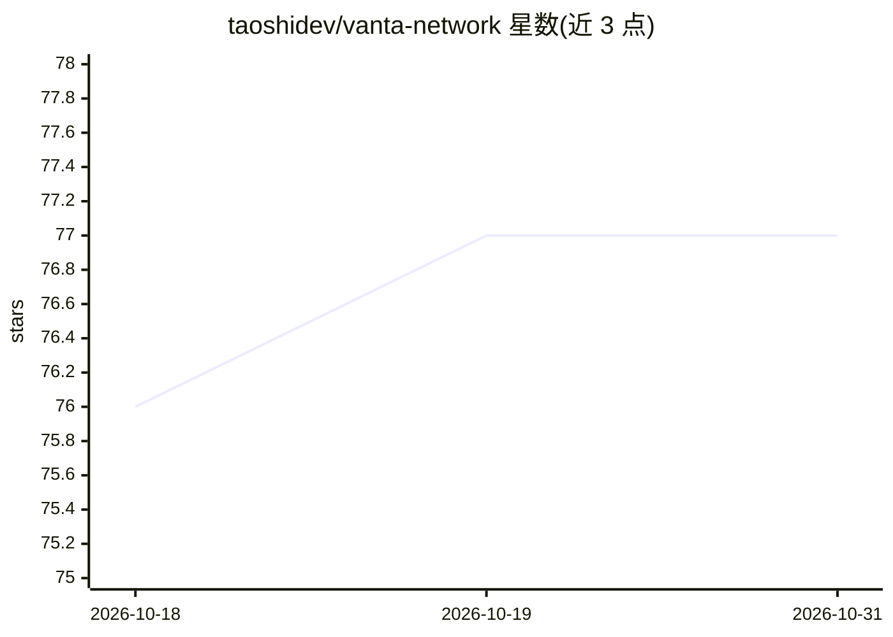

# taoshidev/vanta-network

⭐ 77 · Python · NOASSERTION · 推送 2026-10-29 · [GitHub](https://github.com/taoshidev/vanta-network) · [官网](https://taoshi.io) · 组织维护

**面向 Bittensor 的去中心化量化交易信号网络（原 Proprietary Trading Network）**

Taoshi 开发的 Bittensor 子网：矿工提交外汇、加密货币、股票、大宗商品的多空交易信号，验证者校验交易、记录组合收益并按债务制评分发放激励。规则含抄袭检测、回撤上限（日内5%/高水位8%）、60天不活跃淘汰、持仓费与滑点成本模拟等。仓库提供验证者与矿工安装指引（链接外部指南），并列出 Dashboard、社区与策略构建讨论渠道。MIT 许可。

## 筛选速览

| 维度 | 判定 | 备注 |
|---|---|---|
| AI 角色 | `ai-ecosystem` | LLM/agent 周边工具 |
| 许可风险 | `permissive` | NOASSERTION |
| 部署形态 | `None` |  |
| 模型依赖 | — | README 未给出锁定关系 |
| 硬件要求 | — | 无带数字的原话,不猜 |
| 安装摩擦 | `low` | 无编译、无系统依赖或容器化 |
| 成熟度 | — | 结构信号不足 |

## 能力要点

- 多资产类别（外汇/加密/股票/大宗商品）多空交易信号提交与评分
- 债务制评分与每周 PnL 加权激励发放
- 抄袭检测、回撤上限、试用期与不活跃四类淘汰机制及热钥黑名单
- 验证者与矿工安装指南及交易可视化 Dashboard

## 适用场景

- 量化或深度学习交易系统以矿工身份参与网络获取激励
- 以验证者身份运行节点校验交易信号
- 通过 Dashboard 查看排名靠前交易者的表现

## 场景标签

`金融量化` · 领域:学习与行业

## 证据(README 行号)

> L36: Bittensor is a mining network, similar to Bitcoin, that includes built-in incentives designed to encourage computer
> L44: Subnets are decentralized networks of machines that collaborate to train and serve machine learning models.
> L58: Vanta receives signals from quant and deep learning machine learning trading systems to deliver the world's

## 星数曲线

2026-10-18 76 → 2026-10-31 77（+1）

---
*卡片 v1 · prompt 1.4 · 生成 2026-10-24 · 置信度 high · 依据 README sha `611f984d961a` · [字段定义](../../DATASET.md)*
