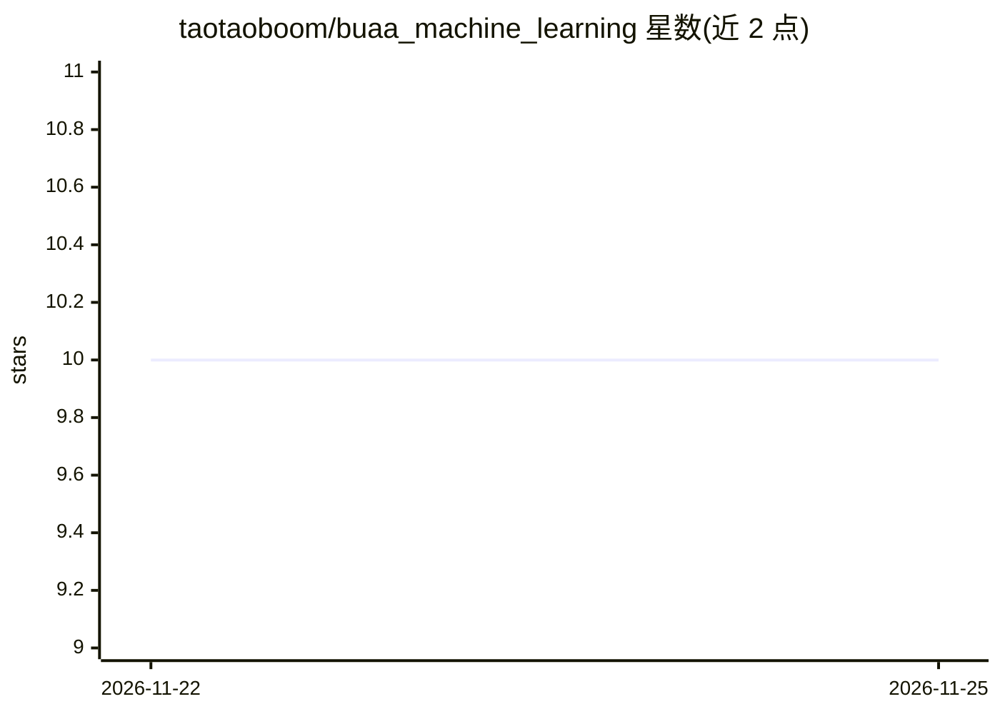

# taotaoboom/buaa_machine_learning

⭐ 10 · 推送 2026-03-29 · [GitHub](https://github.com/taotaoboom/buaa_machine_learning) · 个人维护 · 中文 README

**北航机器学习课程复习资料库：笔记、真题与答案**

北航学生整理的机器学习课程复习资料仓库，核心为作者依据收集资料整理的复习笔记（一本通），另含往年真题及答案、收集的复习笔记。README 记录了课程成绩组成（平时成绩与闭卷期末考试 1:1，期末为 10 道简答题）及考试相关说明，通过邮箱联系作者。面向后续修读该课程的学生，供复习备考使用。

## 筛选速览

| 维度 | 判定 | 备注 |
|---|---|---|
| AI 角色 | `ai-knowledge` | 知识聚合/清单类 |
| 许可风险 | `none` | — |
| 部署形态 | `None` |  |
| 模型依赖 | — | README 未给出锁定关系 |
| 硬件要求 | — | 无带数字的原话,不猜 |
| 安装摩擦 | `low` | 无编译、无系统依赖或容器化 |
| 成熟度 | — | 结构信号不足 |

## 能力要点

- 作者整理的复习笔记（一本通）作为核心资料
- 包含往年真题及答案、收集的复习笔记
- 记录课程成绩组成与考试题型信息

## 适用场景

- 北航机器学习课程期末复习备考
- 查看课程成绩组成与考试题型说明
- 参考往年真题了解考试范围

## 场景标签

 · 领域:教育/课程资料

## 证据(README 行号)

> L2: 本人是2025级秋季学院路校区张小明老师班的学生，在此将本人本学期收集并整理后的复习资料开源，方便后来者复习。**此仓库核心资料为本人依据收集的复习资料整理的复习笔记（一本通）**；另外包括往年真题及答案，收集的复习笔记。
> L8: 刚考完期末考试，强烈推荐我总结的**一本通资料**，**考场上实时对照，命中率达80%，如果仅仅为了考试，期末仅需1-2天突击即可包过**！\

## 星数曲线

2026-11-22 10 → 2026-11-25 10（+0）

---
*卡片 v1 · prompt 1.4 · 生成 2026-11-22 · 置信度 high · 依据 README sha `28303fc69214` · [字段定义](../../DATASET.md)*
