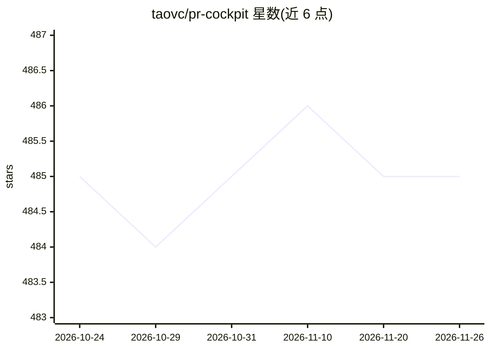

# taovc/pr-cockpit

⭐ 485 · TypeScript · MIT · 推送 2026-11-25 · [GitHub](https://github.com/taovc/pr-cockpit) · 个人维护 · 中文 README

**本地 AI PR 审阅工作台：批量审阅仓库 PR，人工把关后发布**

面向开发者的本地 PR 审阅工作台：通过 gh/GraphQL 拉取仓库的 PR 队列，由 Claude 或 Codex 在隔离的只读 git worktree 中审阅、复核、修复或开发，产出结构化 findings；发布评论需逐条勾选并预览，经 gh API 写回 GitHub，GitHub 保持外部记录系统。每项目可选 provider、模型与审阅方法论；审阅 agent 只读并有工具级阻断。提供三平台桌面安装包（未签名）及源码构建路径。

## 筛选速览

| 维度 | 判定 | 备注 |
|---|---|---|
| AI 角色 | `ai-enhanced` | 去掉 AI 部分产品仍成立 |
| 许可风险 | `permissive` | MIT |
| 部署形态 | `desktop` | 安装包/桌面程序 |
| 模型依赖 | locked-api |  |
| 硬件要求 | — | 无带数字的原话,不猜 |
| 安装摩擦 | `low` | 无编译、无系统依赖或容器化 |
| 成熟度 | `idea` | |

## 能力要点

- Claude/Codex 在隔离只读 worktree 中审阅，产出结构化 findings（严重级、path:line、修复建议）
- 人工勾选把关 + 发布预览，findings 命中变更行时以 inline review comment 发布
- 修复与项目助手在独立 worktree 中进行，默认不 commit/push，需显式确认
- 代码不离开本机，使用本地 Claude/Codex 登录或 API key

## 适用场景

- 批量审阅一个仓库的整个 PR 队列而不逐个开终端
- AI 审阅发现经人工确认后再发布到 GitHub
- 在隔离 worktree 中让 agent 做修复或新分支开发

## 场景标签

`代码审查` `编码 Agent` · 领域:编码与开发

## 证据(README 行号)

> L3:  Review a repo's whole PR queue with Claude or Codex — locally.
> L49: No more reviewing PRs one at a time in the terminal, and no more scattering fixes and feature work across separate 
> L88: Nuxt 4 + @nuxt/ui (Tailwind v4) · better-sqlite3 + drizzle · `@anthropic-ai/claude-agent-sdk` · `@openai/codex-sdk`

## 星数曲线

2026-10-24 485 → 2026-11-26 485（+0）

---
*卡片 v1 · prompt 1.4 · 生成 2026-11-25 · 置信度 mid · 依据 README sha `c82bd0907dc2` · [字段定义](../../DATASET.md)*
