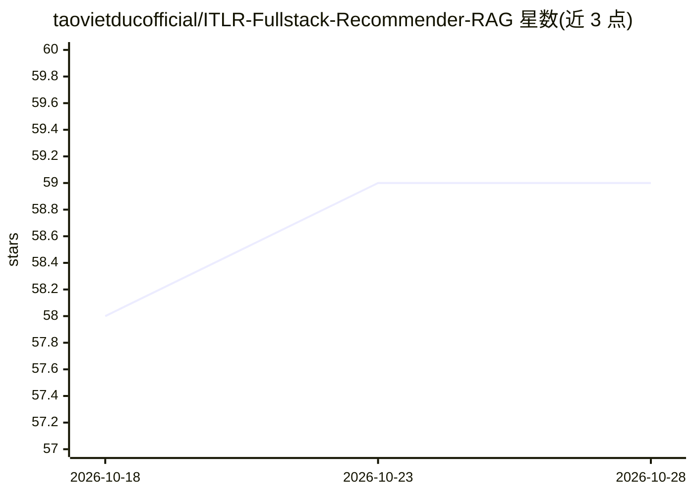

# taovietducofficial/ITLR-Fullstack-Recommender-RAG

⭐ 59 · Jupyter Notebook · NOASSERTION · 推送 2026-10-14 · [GitHub](https://github.com/taovietducofficial/ITLR-Fullstack-Recommender-RAG) · [官网](https://www.facebook.com/CODE4LIFEOFFICIAL) · 个人维护

**越南语 IT 学习平台：混合推荐 + RAG 聊天 + 数据湖仓全栈项目**

面向 IT 学习场景的全栈系统：itlr/（Python，FastAPI）提供混合推荐引擎（TF-IDF/BM25/FAISS/LightGBM LTR 四层排序漏斗）与带 off-topic 闸门的 RAG-Fusion 聊天机器人（LLM 可选 OpenAI/Ollama/离线合成）；web/（Express+TypeScript+PostgreSQL）承担认证、目录、学习进度与社交功能；DataLake/ 为独立 Dagster+Spark+Trino+dbt 数据湖仓模块，经 batch 拉取 web 数据。README 强调全部指标可用 scripts/eval/run_all.py 复现，含 leave-one-out、paired bootstrap 与 off-policy 评估；部署为 Docker Compose 单机 dev/demo 规模，非多节点 HA。

## 筛选速览

| 维度 | 判定 | 备注 |
|---|---|---|
| AI 角色 | `ai-native` | 本体是模型或模型工具 |
| 许可风险 | `none` | NOASSERTION |
| 部署形态 | `self-host` | docker 或自建部署 |
| 模型依赖 | local-ok | 支持本地模型 |
| 硬件要求 | — | 无带数字的原话,不猜 |
| 安装摩擦 | `low` | 无编译、无系统依赖或容器化 |
| 成熟度 | — | 结构信号不足 |

## 能力要点

- 混合推荐：TF-IDF+BM25/FAISS 候选生成 + LTR 重排，LTR serving 比 Cross-Encoder 快约 74×（p50 132ms）
- RAG 聊天带 off-topic 闸门（AUC 0.99，40 句测试集），LLM 多后端（OpenAI→Ollama→离线合成）
- 完整评估框架：NDCG/MAP/MRR/HitRate、paired bootstrap、off-policy IPS/SNIPS/DR，可脚本复现
- 独立 Data Lakehouse 模块（Dagster/Spark/Delta Lake/Trino/dbt/Kafka）通过 group_name 隔离接入平台真实数据

## 适用场景

- 自托管一个带推荐与 RAG 问答的 IT 课程学习平台 demo
- 复现推荐系统与 RAG 的量化评估流程（一键脚本重跑）
- 参考数据湖仓与业务库集成、CI/CD 质量门禁的工程实践

## 场景标签

`聊天机器人` `RAG` `推荐系统` · 领域:对话与助手

## 证据(README 行号)

> L71: - **`itlr/`** (Python) - engine gợi ý + chatbot RAG. Không có UI riêng ngoài trang demo tối giản;
> L142: |Chatbot|RAG-Fusion + MMR, cổng off-topic, LLM đa nhà cung cấp (OpenAI → Ollama → tổng hợp offline)|

## 星数曲线

2026-10-18 58 → 2026-10-28 59（+1）

---
*卡片 v1 · prompt 1.4 · 生成 2026-10-24 · 置信度 high · 依据 README sha `de6f2d6188c9` · [字段定义](../../DATASET.md)*
