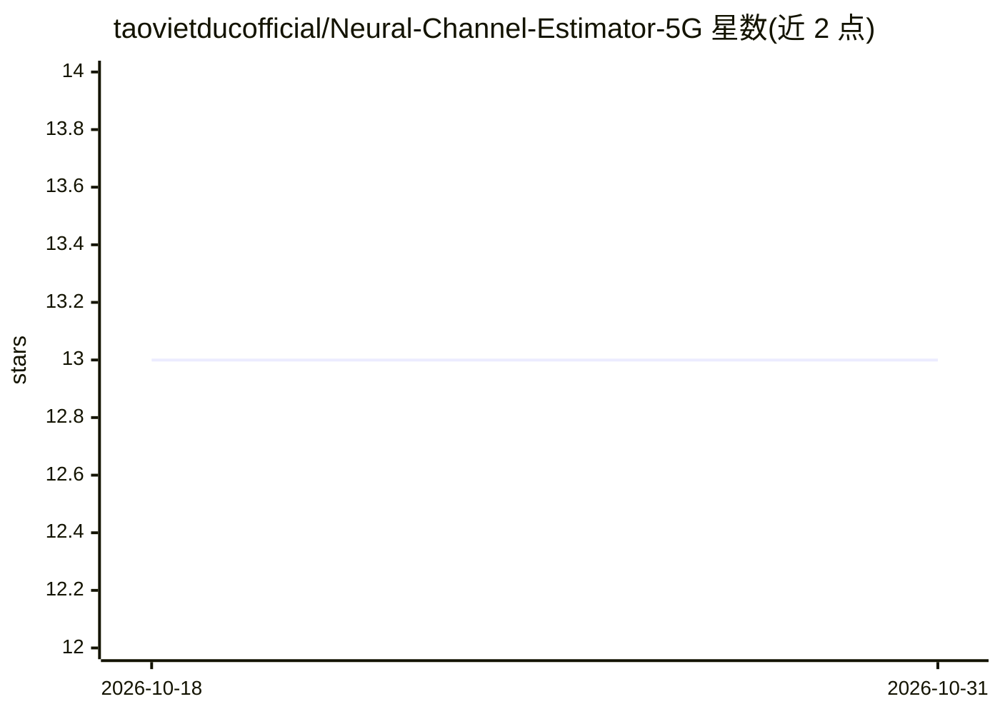

# taovietducofficial/Neural-Channel-Estimator-5G

⭐ 13 · Python · NOASSERTION · 推送 2026-10-09 · [GitHub](https://github.com/taovietducofficial/Neural-Channel-Estimator-5G) · [官网](https://www.facebook.com/CODE4LIFEOFFICIAL) · 个人维护 · 中文 README

**基于 Sionna 的 5G NR 神经信道估计器：CNN/Transformer 模型加 ONNX 推理服务**

在 NVIDIA Sionna 2.0 的 5G NR PUSCH 链路仿真中，用 CNN 与 Transformer 两种神经网络替换经典 LS+LMMSE 信道估计组件，训练数据由仿真器按需生成、无需外部数据集。训练后模型导出为 ONNX 并经数值一致性校验，封装为 FastAPI REST 服务与 Docker 容器，带可点击 demo 页、Prometheus 指标与模型溯源清单。README 自述为研究/作品集级仿真而非现场部署验证，CPU 上 p99 时延不满足 1ms/0.25ms 时隙预算。

## 筛选速览

| 维度 | 判定 | 备注 |
|---|---|---|
| AI 角色 | `ai-native` | 本体是模型或模型工具 |
| 许可风险 | `none` | NOASSERTION |
| 部署形态 | `self-host` | docker 或自建部署 |
| 模型依赖 | — | README 未给出锁定关系 |
| 硬件要求 | — | 无带数字的原话,不猜 |
| 安装摩擦 | `low` | 无编译、无系统依赖或容器化 |
| 成熟度 | `idea` | |

## 能力要点

- CNN 与 Transformer 两种架构在同一任务上对比评测（BLER vs SNR）
- 模型导出 ONNX（与 PyTorch 原模型数值偏差约千万分之一）并容器化为 FastAPI 服务
- 模型溯源：导出记录含 checkpoint SHA-256、opset、训练超参与最终损失
- 训练数据由 Sionna 仿真按需生成，不依赖外部数据集

## 适用场景

- 在 5G NR 上行链路仿真中研究神经网络信道估计的准确率与时延
- 复现并重新评测经典估计器与神经估计器的 BLER 对比结果
- 将训练好的估计模型作为 REST 服务部署与演示

## 场景标签

`科研工具` · 领域:学习与行业

## 证据(README 行号)

> L15: |**What it is**|A neural network (CNN and Transformer variants) that estimates the radio channel more accurately th
> L152: 2. **The neural network is a drop-in replacement** for one specific

## 星数曲线

2026-10-18 13 → 2026-10-31 13（+0）

---
*卡片 v1 · prompt 1.4 · 生成 2026-10-31 · 置信度 high · 依据 README sha `9fdac0ccc188` · [字段定义](../../DATASET.md)*
