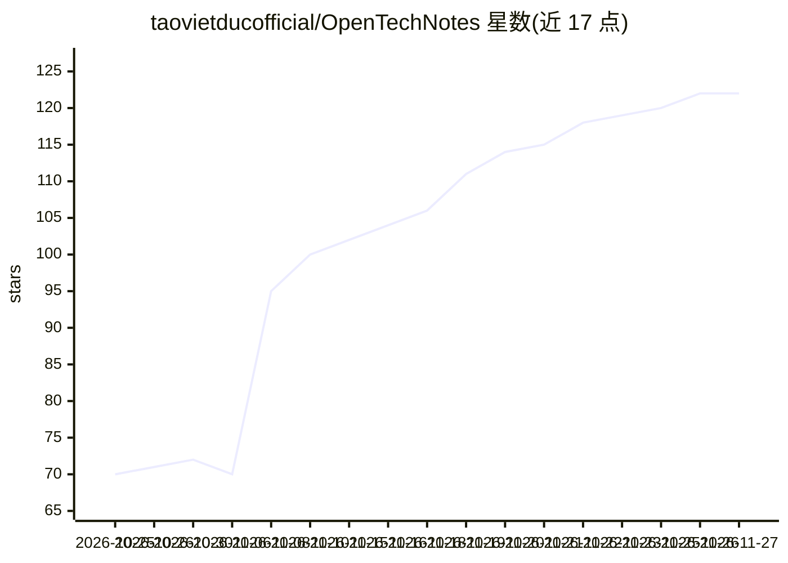

# taovietducofficial/OpenTechNotes

⭐ 122 · 推送 2026-11-23 · [GitHub](https://github.com/taovietducofficial/OpenTechNotes) · [官网](https://www.facebook.com/CODE4LIFEOFFICIAL) · 个人维护 · 中文 README

**面向 IT 学习者的开源技术笔记与学习资源合集**

以越南语为主维护的开源仓库，集中收录技术文档、笔记与软件开发知识，主题计划覆盖编程、数据结构与算法、软件工程、系统设计、数据库、后端开发、DevOps、云计算、AI、RAG 与 AI Agents 等。面向 IT 学生、编程初学者、Fresher/Junior 开发者及想梳理知识体系的开发者，通过 GitHub Fork/PR 方式接受社区贡献。README 声明将持续更新主题内容。

## 筛选速览

| 维度 | 判定 | 备注 |
|---|---|---|
| AI 角色 | `ai-knowledge` | 知识聚合/清单类 |
| 许可风险 | `none` | — |
| 部署形态 | `None` |  |
| 模型依赖 | — | README 未给出锁定关系 |
| 硬件要求 | — | 无带数字的原话,不猜 |
| 安装摩擦 | `low` | 无编译、无系统依赖或容器化 |
| 成熟度 | — | 结构信号不足 |

## 能力要点

- 集中式技术笔记与学习资源仓库
- 覆盖编程、系统设计、DevOps、AI/RAG/AI Agents 等主题
- 通过 Fork/分支/PR 流程接受社区贡献

## 适用场景

- 初学者按主题查找 IT 基础与实战笔记
- Fresher/Junior 开发者梳理知识体系
- 开发者跟踪 AI、RAG、AI Agents 等主题的资料更新

## 场景标签

`教程课程` `精选清单` · 领域:学习与行业

## 证据(README 行号)

> L3: > Open-source technical notes and learning resources for developers and IT learners.
> L11: Repository sẽ tiếp tục được cập nhật với các chủ đề như:

## 星数曲线

2026-10-25 70 → 2026-11-27 122（+52）

---
*卡片 v1 · prompt 1.4 · 生成 2026-10-24 · 置信度 high · 依据 README sha `0b0255fe6dfe` · [字段定义](../../DATASET.md)*
