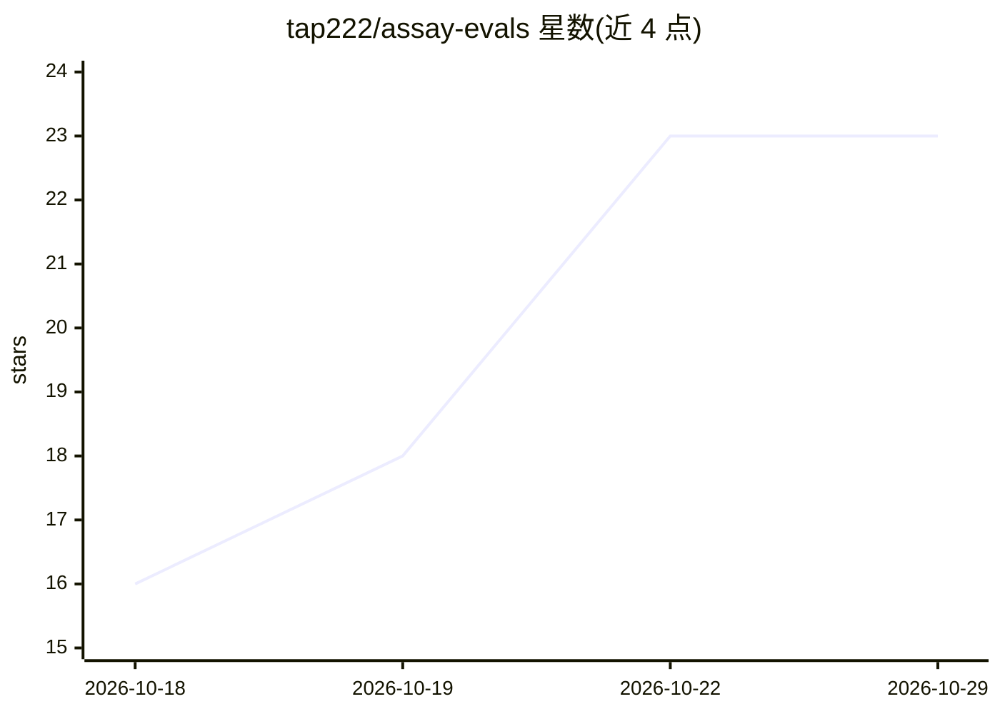

# tap222/assay-evals

⭐ 23 · Python · MIT · 推送 2026-10-22 · [GitHub](https://github.com/tap222/assay-evals) · [官网](https://docai-eval.vercel.app) · 个人维护

**面向 AI 应用与 agent 的行为回归测试框架（pytest 插件）**

为 Python 与 TypeScript 的 AI 应用和 agent 提供行为回归测试：以 pytest 插件和 Jest/Vitest 辅助形式，将每个测试用例与其上一次通过运行对比（检查、工具调用顺序、成本与上下文），输出变更 diff 与严重度；通过重复尝试区分真实回归与噪声，提供 judge 校准、agent 轨迹契约、RAG 忠实度检查、文档抽取字段级指标与逐字段门禁，以及 GitHub Action PR 检查。安装途径为 PyPI 的 assay-server 与 npm 的 assay-evals。

## 筛选速览

| 维度 | 判定 | 备注 |
|---|---|---|
| AI 角色 | `ai-ecosystem` | LLM/agent 周边工具 |
| 许可风险 | `permissive` | MIT |
| 部署形态 | `self-host` | docker 或自建部署 |
| 模型依赖 | — | README 未给出锁定关系 |
| 硬件要求 | — | 无带数字的原话,不猜 |
| 安装摩擦 | `low` | 无编译、无系统依赖或容器化 |
| 成熟度 | — | 结构信号不足 |

## 能力要点

- pytest 插件 + Jest/Vitest 辅助，逐用例对比上次通过运行
- 重复尝试区分真实回归、噪声与无法判定（独立退出码 6）
- 文档抽取字段级指标：类型化匹配、行项目配对、OCR 误差率、逐字段门禁
- GitHub Action 在 PR 中比较默认分支上次通过运行并发布 diff 评论

## 适用场景

- AI 应用改提示词或换模型后，找出哪些用例行为退化
- 在 CI 中对 agent/RAG/文档抽取变更做回归门禁
- 审计 PR 是否删除或放宽断言以绕过测试

## 场景标签

`模型评测` · 领域:评测与运维

## 证据(README 行号)

> L4:  Behavioral regression testing for AI apps and agents in Python and TypeScript: a pytest plugin, a Jest and Vitest h
> L30: changed or whether it matters. Assay compares every test case with its own last passing run, then

## 星数曲线

2026-10-18 16 → 2026-10-29 23（+7）

---
*卡片 v1 · prompt 1.4 · 生成 2026-10-27 · 置信度 mid · 依据 README sha `793a148f6989` · [字段定义](../../DATASET.md)*
