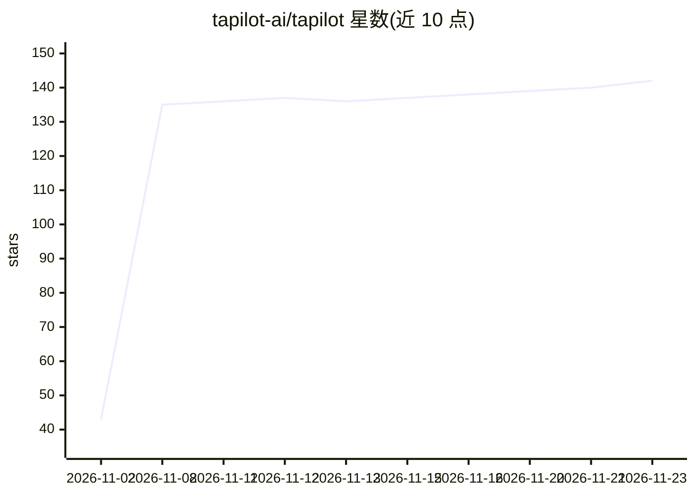

# tapilot-ai/tapilot

⭐ 142 · HTML · MIT · 推送 2026-11-05 · [GitHub](https://github.com/tapilot-ai/tapilot) · [官网](https://tapilot.lifeos.md) · 组织维护 · 中文 README

**用自然语言操控 Android 手机的 AI agent 应用**

运行在 arm64 Android 11+ 手机上的原生应用：用户以自然语言下达任务，由 Midscene 提供基于截图的视觉规划、定位与动作执行，通过 Android 无障碍权限操作屏幕，完成跨应用任务并生成 HTML 回放报告。日常使用无需 ADB、Shizuku 或 root，但需配置远程视觉模型 API；端侧编排不等于离线推理。支持语音输入（Volcengine/Deepgram 可选）、Wi-Fi 电脑端控制插件及实验性后台屏幕功能。项目自述为实验性。

## 筛选速览

| 维度 | 判定 | 备注 |
|---|---|---|
| AI 角色 | `ai-native` | 本体是模型或模型工具 |
| 许可风险 | `permissive` | MIT |
| 部署形态 | `library` | 以包/库形式分发 |
| 模型依赖 | — | README 未给出锁定关系 |
| 硬件要求 | — | 无带数字的原话,不猜 |
| 安装摩擦 | `medium` | 含编译或系统依赖之一 |
| 成熟度 | `idea` | |

## 能力要点

- 自然语言驱动的截屏视觉理解与跨应用任务执行（Midscene）
- 支持任务接管/继续、逐步骤截图校验与 HTML 回放报告
- 可选 Volcengine/Deepgram 语音转录与语音播放
- Wi-Fi 电脑端控制插件（pinned TLS）与实验性后台屏幕

## 适用场景

- 让手机按一句话完成跨应用的查找与操作任务
- 动口不动手：用语音向手机下达指令
- 在电脑上通过 Wi-Fi 远程操控已配对的手机

## 场景标签

`GUI 自动化` · 领域:效率与自动化

## 证据(README 行号)

> L5: **Give your Android phone a task in plain language.**
> L37: - **Operate apps in natural language.** Tap, swipe, scroll, type, launch apps and
> L115: Midscene supplies the visual planning, locating, action execution and reports.

## 星数曲线

2026-11-02 43 → 2026-11-23 142（+99）

---
*卡片 v1 · prompt 1.4 · 生成 2026-11-17 · 置信度 mid · 依据 README sha `db8eac21885b` · [字段定义](../../DATASET.md)*
