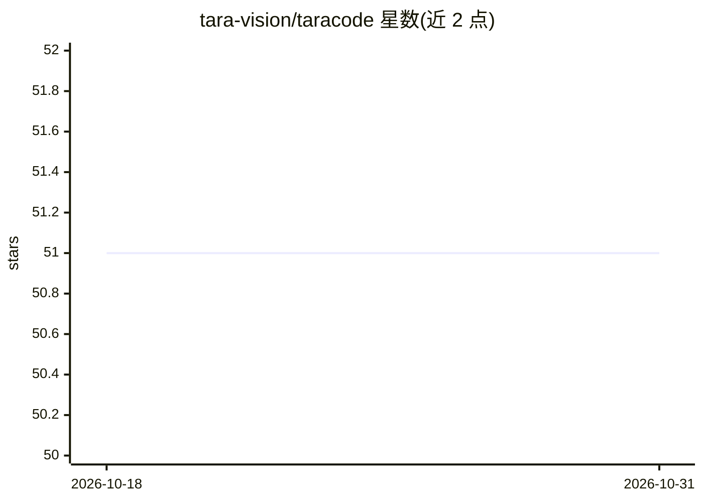

# tara-vision/taracode

⭐ 51 · Go · MIT · 推送 2026-10-29 · [GitHub](https://github.com/tara-vision/taracode) · [官网](https://code.tara.vision) · 组织维护

**本地运行的 DevOps/云基础设施 AI 助手 CLI**

面向 Kubernetes、Terraform、Docker 与多云场景的终端 AI 助手，运行在本地 taraengine 推理引擎上，数据不出本机。双模式设计：investigate 模式默认只读且从不弹窗；operate 模式下所有变更经保护目标、拒绝模式与必需 dry-run 的策略门控，15 个工具按参数分类读/写，工具输出先做密钥脱敏并记录审计日志。附本地模型 DevOps 能力公开积分榜。安装可选 curl 脚本、Homebrew、go install 或发布页二进制；Intel Mac 可用 --host 指向其他 OpenAI 兼容服务（vLLM/llama.cpp）。

## 筛选速览

| 维度 | 判定 | 备注 |
|---|---|---|
| AI 角色 | `ai-native` | 本体是模型或模型工具 |
| 许可风险 | `permissive` | MIT |
| 部署形态 | `library` | 以包/库形式分发 |
| 模型依赖 | local-ok | 支持本地模型 |
| 硬件要求 | — | 无带数字的原话,不猜 |
| 安装摩擦 | `medium` | 含编译或系统依赖之一 |
| 成熟度 | — | 结构信号不足 |

## 能力要点

- 默认 investigate 只读模式与策略门控的 operate 模式（保护目标/拒绝模式/dry-run）
- 15 个工具按参数而非名称分类读/写，密钥脱敏与变更审计日志
- 本地模型 DevOps 任务通过率积分榜（RTX 5090 与 M4 Max 实测）
- 发布二进制附带 checksums、cosign 签名与 SLSA provenance

## 适用场景

- 运维/SRE 在终端查询与排查 Kubernetes、Terraform 等基础设施
- 在策略门控下让 AI 执行基础设施变更操作
- 隐私敏感环境下用本地模型完成 DevOps 问答与操作

## 场景标签

 · 领域:DevOps/云基础设施

## 证据(README 行号)

> L3:  DevOps & Cloud SI Assistant
> L35: - **Privacy-first** - Runs fully local on taraengine, your data never leaves your machine

## 星数曲线

2026-10-18 51 → 2026-10-31 51（+0）

---
*卡片 v1 · prompt 1.4 · 生成 2026-10-24 · 置信度 high · 依据 README sha `697c4e6af886` · [字段定义](../../DATASET.md)*
