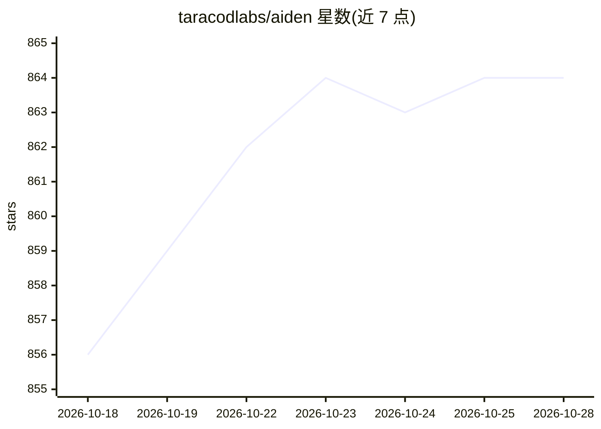

# taracodlabs/aiden

⭐ 866 · TypeScript · AGPL-3.0 · 推送 2026-10-19 · [GitHub](https://github.com/taracodlabs/aiden) · [官网](https://aiden.taracod.com) · 个人维护

**自主 AI 工作引擎：给目标，跨文件/终端/浏览器执行并验证结果**

以 TypeScript/Node.js 实现的自主 AI agent 运行时：接收目标后规划多步骤任务，操作本地文件、终端命令、浏览器（Playwright/Chromium）、应用、API、MCP 服务器与消息渠道（Discord/Slack/Telegram/Email/Webhook）。以 Job/Attempt/Evidence/Verification/Proof 分离跟踪执行，支持风险分级审批、子代理、守护进程触发器（文件/定时/邮件/Webhook）与记忆图。模型接入 Groq/Anthropic/OpenAI/Gemini/Ollama 及自定义端点（BYOK）。通过 npm 安装，支持 Windows/Linux/WSL/macOS API 模式，需 Node 20/22。个人独立开发，AGPL-3.0。

## 筛选速览

| 维度 | 判定 | 备注 |
|---|---|---|
| AI 角色 | `ai-native` | 本体是模型或模型工具 |
| 许可风险 | `viral` | AGPL-3.0 |
| 部署形态 | `library` | 以包/库形式分发 |
| 模型依赖 | local-ok | 支持本地模型 |
| 硬件要求 | — | 无带数字的原话,不猜 |
| 安装摩擦 | `low` | 无编译、无系统依赖或容器化 |
| 成熟度 | — | 结构信号不足 |

## 能力要点

- 目标→计划→执行→证据→验证的作业跟踪模型
- 操作文件/终端/浏览器/API/MCP/仓库与多个消息渠道
- 风险分级审批、预算、租约与守护进程自动化触发
- 多 provider 选择含 Ollama 本地与 BYOK 自定义端点

## 适用场景

- 让 agent 全程完成代码库分析、修复并跑测试验证
- 浏览器表单填写、网站操作与结果捕获的自动化
- 监控文件夹/邮件/Webhook 触发后台自动化任务
- 研究多来源并产出结构化 Markdown 报告

## 场景标签

`浏览器自动化` `编码 Agent` `工作流自动化` · 领域:效率与自动化

## 证据(README 行号)

> L12: **Autonomous Work Engine — plans, acts, recovers, and proves the result**
> L87: > **Aiden is an autonomous AI engine for real computer work.** It can plan multi-step jobs, use your files, termina
> L136: - **Use the models you prefer.** Choose among multiple providers, subscription-backed sign-in where supported, cus

## 星数曲线

2026-10-18 856 → 2026-10-28 864（+8）

---
*卡片 v1 · prompt 1.4 · 生成 2026-10-21 · 置信度 high · 依据 README sha `eb758090c6fe` · [字段定义](../../DATASET.md)*
