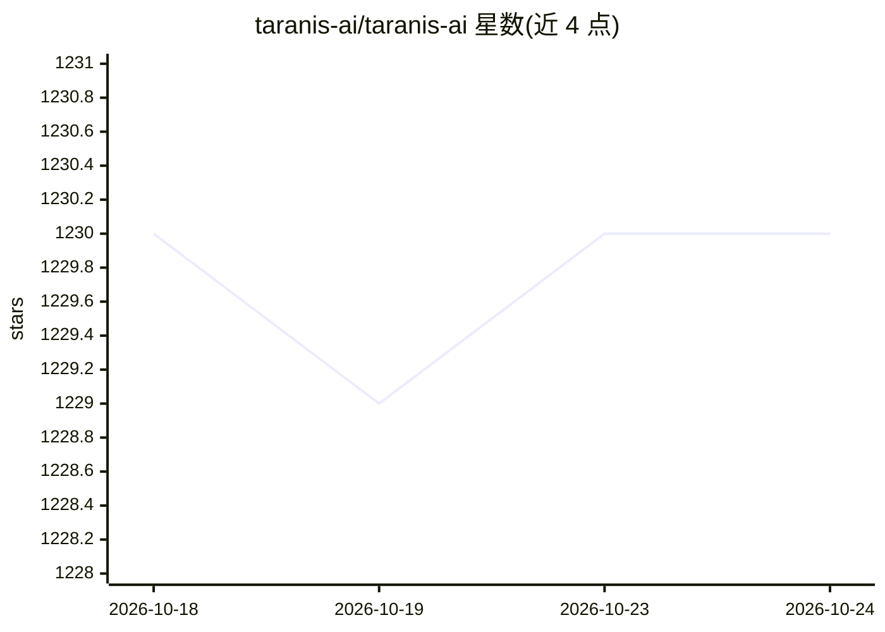

# taranis-ai/taranis-ai

⭐ 1,230 · Python · EUPL-1.2 · 推送 2026-10-23 · [GitHub](https://github.com/taranis-ai/taranis-ai) · [官网](https://taranis.ai/) · 组织维护

**面向情报分析师的开源 OSINT 采集与报告平台**

开源情报（OSINT）工具：worker 从网站、RSS/Atom、Mastodon、MISP、Request Tracker 等来源采集非结构化新闻，用 NLP 与 AI 增强内容质量，分析师将 AI 增强后的文章整理为结构化报告并生成 PDF 等成品发布。架构含 Nginx 入口、Flask/HTMX 前端、core REST 后端、RQ worker，支持 PostgreSQL/SQLite 与 Redis；生产部署走 docker compose，并提供 OpenAI 兼容 Responses API 的可选分析员聊天与 MISP 共享（实验性）。使用全部 NLP 功能需 16 GB RAM、4 核、50 GB 磁盘。

## 筛选速览

| 维度 | 判定 | 备注 |
|---|---|---|
| AI 角色 | `ai-enhanced` | 去掉 AI 部分产品仍成立 |
| 许可风险 | `viral` | EUPL-1.2 |
| 部署形态 | `self-host` | docker 或自建部署 |
| 模型依赖 | — | README 未给出锁定关系 |
| 硬件要求 | — | 无带数字的原话,不猜 |
| 安装摩擦 | `low` | 无编译、无系统依赖或容器化 |
| 成熟度 | `idea` | |

## 能力要点

- 多源采集（网站/RSS/Mastodon/MISP/Request Tracker）生成新闻条目
- NLP 与 AI 自动增强和丰富采集到的文章
- 分析师工作流：非结构化新闻转为结构化报告并输出 PDF 发布
- 可选分析员聊天（OpenAI 兼容 Responses API）与实例间 MISP 共享（实验性）

## 适用场景

- 安全分析师聚合多源情报并生成结构化威胁情报报告
- 团队协作产出并发布 PDF 情报成品
- 通过 MISP 与其他 Taranis AI 实例或平台共享情报

## 场景标签

`网页抓取` `网络安全` · 领域:效率与自动化

## 证据(README 行号)

> L5: Taranis AI is an advanced Open-Source Intelligence (OSINT) tool, leveraging Artificial Intelligence to revolutionize
> L7: Taranis navigates through diverse data sources like websites to collect unstructured news articles, utilizing Natura
> L56: * AI-Enhanced Analysis: Utilizes Artificial Intelligence and Natural Language Processing to automatically enhance a

## 星数曲线

2026-10-18 1,230 → 2026-10-24 1,230（+0）

---
*卡片 v1 · prompt 1.4 · 生成 2026-10-21 · 置信度 high · 依据 README sha `a8962cacc8d0` · [字段定义](../../DATASET.md)*
