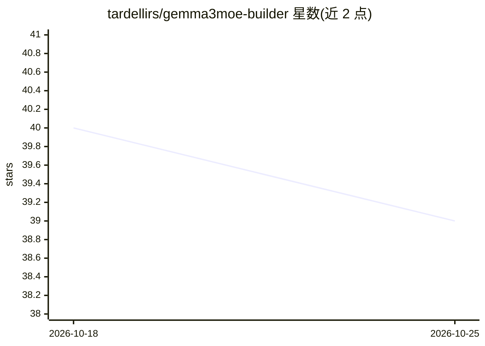

# tardellirs/gemma3moe-builder

⭐ 39 · Python · NOASSERTION · 推送 2026-07-27 · [GitHub](https://github.com/tardellirs/gemma3moe-builder) · 个人维护

**将 Gemma-3-270m 稀疏升环为 MoE 并在 CPU 上服务的工具包**

轻依赖 Python 工具包，把稠密 Gemma-3-270m 检查点 sparse-upcycle 为路由 MoE（线性 router + N 个 Gemma3MLP 专家、top-k 重归一化），支持复制初始化或多源多样初始化、Transformers Trainer 继续训练、路由健康度检查（负载均衡/死专家/熵），并提供补丁让模型在 llama.cpp 上以 CPU 运行（自定义 gemma3moe 架构、GGUF 转换、全 K 量化）。提供 16 专家 top-4 的未训练起始检查点。活跃参数决定 CPU 延迟，8×top-2 约 213M 活跃参数。面向做小模型实验的开发者与研究者。

## 筛选速览

| 维度 | 判定 | 备注 |
|---|---|---|
| AI 角色 | `ai-native` | 本体是模型或模型工具 |
| 许可风险 | `none` | NOASSERTION |
| 部署形态 | `library` | 以包/库形式分发 |
| 模型依赖 | local-ok | 支持本地模型 |
| 硬件要求 | — | 无带数字的原话,不猜 |
| 安装摩擦 | `low` | 无编译、无系统依赖或容器化 |
| 成熟度 | — | 结构信号不足 |

## 能力要点

- 把任意 Gemma-3-270m 检查点升环为 N 专家 top-k MoE，copy-init 时与稠密模型逐字节等价
- 多源多样初始化：专家可由不同 Gemma-3-270m 变体种子（FFN 与词表无关）
- llama.cpp 补丁支持 CPU 服务：自定义 gemma3moe 架构、GGUF、全部 K 量化
- 路由检查工具：负载均衡、死专家、熵、与稠密模型的特化对比

## 适用场景

- 把 270m 小模型扩成参数更多但 CPU 推理开销接近的 MoE
- 继续训练/微调自定义 MoE 并导出 GGUF 在 llama.cpp CPU 上运行
- 分析 MoE 路由行为（负载均衡、专家特化）
- 扫描不同 k 与量化档位的 tok/s 和峰值内存

## 场景标签

 · 领域:机器学习/模型构建工具

## 证据(README 行号)

> L11: `gemma3moe-builder` is a small, dependency-light toolkit that **sparse-upcycles** a dense Gemma-3-270m
> L147:   modeling_gemma3_moe.py   # the gemma3moe Transformers architecture (router + N experts, top-k)
> L154: `gemma3moe` keeps the entire Gemma-3 stack and replaces each layer's dense `Gemma3MLP` with a

## 星数曲线

2026-10-18 40 → 2026-10-25 39（-1）

---
*卡片 v1 · prompt 1.4 · 生成 2026-10-25 · 置信度 high · 依据 README sha `d87d64bc126b` · [字段定义](../../DATASET.md)*
