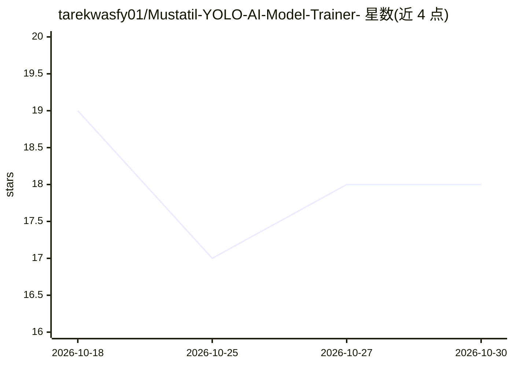

# tarekwasfy01/Mustatil-YOLO-AI-Model-Trainer-

⭐ 18 · Python · LGPL-3.0 · 推送 2026-10-02 · [GitHub](https://github.com/tarekwasfy01/Mustatil-YOLO-AI-Model-Trainer-) · [官网](https://mustatil.de) · 个人维护

**GIS 级 AI 视觉工作台：标注、训练、检测与 GIS 导出**

桌面端 GIS AI 视觉工作台，面向遥感、卫星影像与考古数据集，提供标注工作流、YOLO 训练与检测、大幅面/GeoTIFF/BigTIFF 切片推理、基于地图的检测结果审校与修正、GeoPackage 等 GIS 格式导出，以及图形化 AI 管道构建。支持 RF-DETR、Mask R-CNN、U-Net、SAM2、Grounding DINO、OWL-ViT/OWLv2 等多种视觉模型工作流。安装途径覆盖 pip、conda、snap、Windows/macOS/Linux 安装包及 Microsoft Store（v6）；作者同时声明 v6 仍在开发中，推荐免费的 5.6 稳定版。

## 筛选速览

| 维度 | 判定 | 备注 |
|---|---|---|
| AI 角色 | `ai-native` | 本体是模型或模型工具 |
| 许可风险 | `viral` | LGPL-3.0 |
| 部署形态 | `desktop` | 安装包/桌面程序 |
| 模型依赖 | — | README 未给出锁定关系 |
| 硬件要求 | — | 无带数字的原话,不猜 |
| 安装摩擦 | `low` | 无编译、无系统依赖或容器化 |
| 成熟度 | `idea` | |

## 能力要点

- 标注、YOLO 训练、切片推理与 GIS 导出的完整工作流
- 支持 SAM2、Grounding DINO、OWL-ViT/OWLv2、U-Net 等多模型工作流
- 大幅面图像与 GeoTIFF/BigTIFF 卫星影像处理
- 提供 Windows/macOS/Linux 安装包、pip/conda/snap 多种安装方式

## 适用场景

- 考古遥感和卫星影像上的目标检测
- 训练和审校自定义目标检测数据集
- 将检测结果导出为 GeoPackage 供 QGIS 等 GIS 软件使用

## 场景标签

`目标检测` `模型训练` · 领域:感知与多模态

## 证据(README 行号)

> L63: **Mustatil** is a GIS-level AI vision workspace for **annotation**, **YOLO training**, **large-scale object detecti
> L131: - Support for RF-DETR, R-CNN, Mask R-CNN, U-Net, SAM2, ADAF, Grounding DINO, LAE-DINO, OWL-ViT / OWLv2, and relate

## 星数曲线

2026-10-18 19 → 2026-10-30 18（-1）

---
*卡片 v1 · prompt 1.4 · 生成 2026-10-29 · 置信度 high · 依据 README sha `29f2b3c84b32` · [字段定义](../../DATASET.md)*
