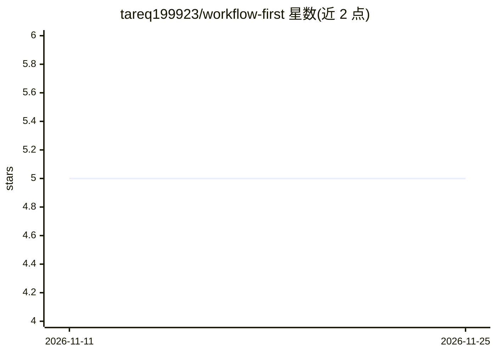

# tareq199923/workflow-first

⭐ 5 · Python · MIT · 推送 2026-11-13 · [GitHub](https://github.com/tareq199923/workflow-first) · 个人维护

**通过访谈生成 WORKFLOW.md 设计文档并校验的 agent skill**

面向在动手前需要决定 AI 项目架构方式的开发者：agent skill 以逐题访谈收集目标、复杂度位置、工具与模型选择、RAG/记忆、路由、停止条件、护栏与评测等信息，据此生成 WORKFLOW.md 设计文档，再用纯 Python 脚本（Python 3、无额外依赖）做结构校验并输出 OK/FAIL。核心规则是代码优先，只有当简单设计经测量失败才向 agent 化方向推进。提供轻量（7 节）与完整（14 节）两套模板，支持 Claude Code、OpenAI Codex 与 OpenCode 三种 skill 目录安装。状态为 pre-release v0.x。

## 筛选速览

| 维度 | 判定 | 备注 |
|---|---|---|
| AI 角色 | `ai-ecosystem` | LLM/agent 周边工具 |
| 许可风险 | `permissive` | MIT |
| 部署形态 | `library` | 以包/库形式分发 |
| 模型依赖 | — | README 未给出锁定关系 |
| 硬件要求 | — | 无带数字的原话,不猜 |
| 安装摩擦 | `low` | 无编译、无系统依赖或容器化 |
| 成熟度 | `idea` | |

## 能力要点

- 四档设计光谱（plain code→workflow→单 agent→多 agent）的访谈式定位
- check_workflow.py 纯 Python 校验器，支持 --early 与 --allow-open 模式
- check_evals.py 校验 eval YAML 文件与文档中的评测数量交叉核对
- 20 项护栏清单与必须先建 baseline 的测量规则

## 适用场景

- 启动一个含 LLM/agent/RAG 的项目前决定用代码还是 agent
- 把已有设计迁移到更复杂的 agent 模式前做结构审查
- 为 agent 系统编写并通过校验的评测任务清单

## 场景标签

`模型评测` `提示工程` · 领域:Agent 开发

## 证据(README 行号)

> L5: `workflow-first` is an agent skill that helps you decide how to build an AI-powered project before you build it. It 
> L7: The skill is built around one rule: **start as far left as you can, and move right only when the simpler design has 
> L114: `workflow-first` is a folder-based skill. Install the **entire repository folder**, not just `SKILL.md`: the skill

## 星数曲线

2026-11-11 5 → 2026-11-25 5（+0）

---
*卡片 v1 · prompt 1.4 · 生成 2026-11-21 · 置信度 mid · 依据 README sha `2ada5f4f5d28` · [字段定义](../../DATASET.md)*
