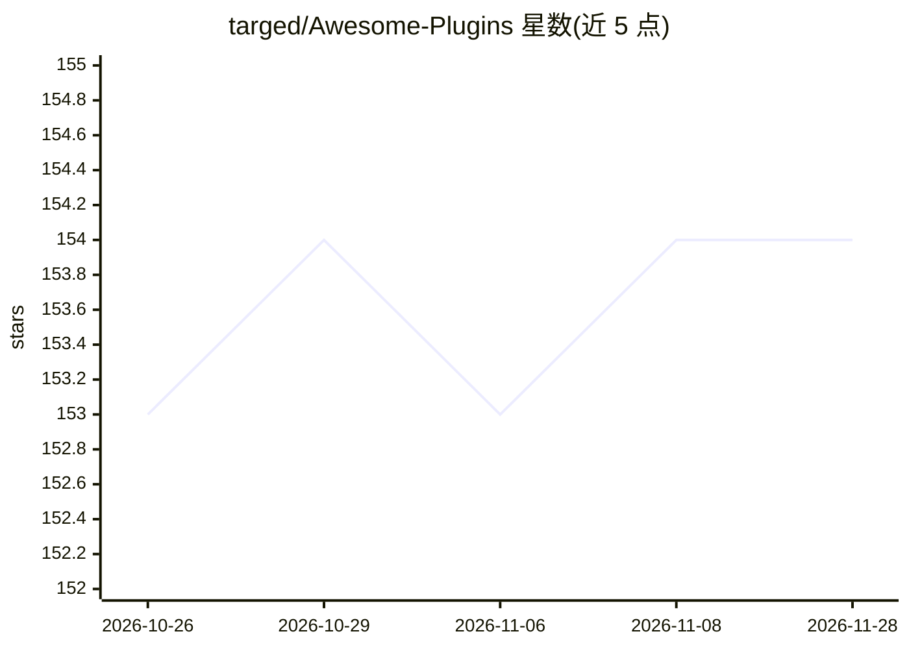

# targed/Awesome-Plugins

⭐ 154 · JSON · MIT · 推送 2026-11-27 · [GitHub](https://github.com/targed/Awesome-Plugins) · 个人维护

**ChatGPT 等语言模型插件的策展清单与在线状态页**

仓库定位为 ChatGPT 及兼容 GPT 架构的语言模型的插件、附加组件与扩展清单，并允许用户提交新插件。README 当前内容为基于 Upptime 的开源在线状态监控页：用 GitHub Issues 记录事故、Actions 执行可用性监测、Pages 生成状态页，表格列出各插件站点的响应时间与历史可用率。清单本体条目通过外链查看，README 内不含插件明细与安装说明。

## 筛选速览

| 维度 | 判定 | 备注 |
|---|---|---|
| AI 角色 | `ai-knowledge` | 知识聚合/清单类 |
| 许可风险 | `permissive` | MIT |
| 部署形态 | `library` | 以包/库形式分发 |
| 模型依赖 | — | README 未给出锁定关系 |
| 硬件要求 | — | 无带数字的原话,不猜 |
| 安装摩擦 | `low` | 无编译、无系统依赖或容器化 |
| 成熟度 | — | 结构信号不足 |

## 能力要点

- 收录面向 ChatGPT 及 GPT 兼容模型的插件、附加组件与扩展
- 基于 Upptime 的自动在线状态监控与状态页（Issues+Actions+Pages）
- 提供插件提交入口

## 适用场景

- 查找 ChatGPT 生态中的插件与扩展
- 查看各插件站点的实时可用性与响应时间
- 提交发现的插件到清单

## 场景标签

`精选清单` · 领域:学习与行业

## 证据(README 行号)

> L7: This repository contains the open-source uptime monitor and status page for targed, powered by Upptime.
> L15: With Upptime, you can get your own unlimited and free uptime monitor and status page, powered entirely by a GitHub 

## 星数曲线

2026-10-26 153 → 2026-11-28 154（+1）

---
*卡片 v1 · prompt 1.4 · 生成 2026-11-28 · 置信度 low · 依据 README sha `62e5245e5fff` · [字段定义](../../DATASET.md)*
