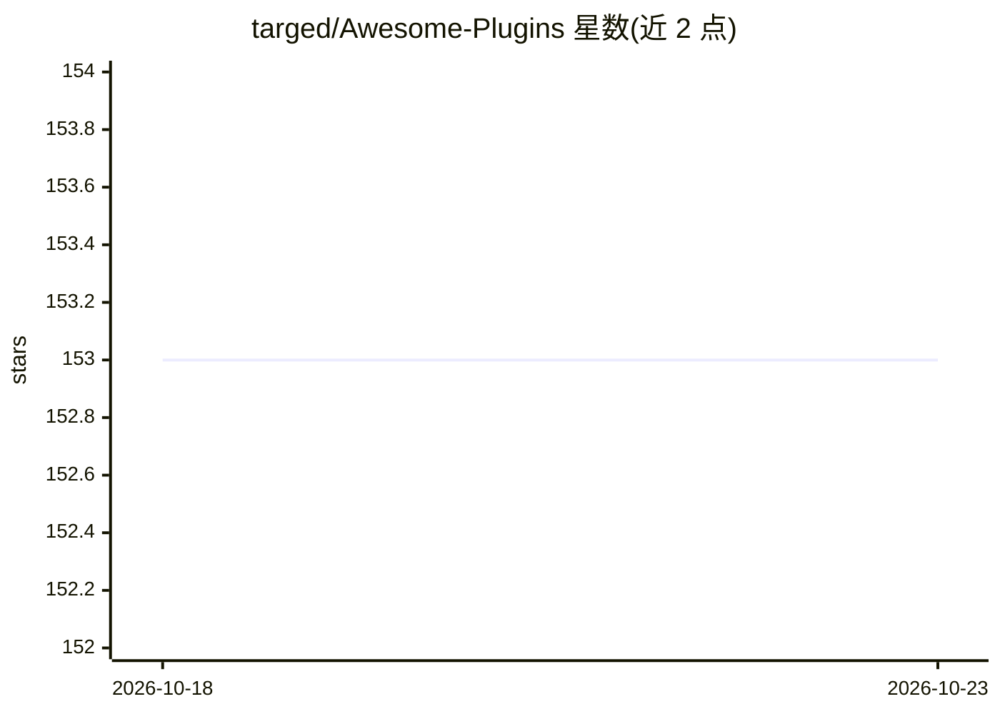

# targed/Awesome-Plugins

⭐ 153 · JSON · MIT · 推送 2026-10-22 · [GitHub](https://github.com/targed/Awesome-Plugins) · 个人维护

**ChatGPT 及 GPT 兼容模型插件清单，附插件可用性状态页**

面向 ChatGPT 插件生态的策展清单仓库，按仓库描述收录插件、附加组件与扩展，并提供提交入口与插件详情链接。README 实际内容为基于 Upptime 的开源可用性监控状态页：通过 GitHub Issues、Actions 与 Pages 运行，以表格列出各被监控插件（如 Algorithma、Binance、Coursera 等）的上下行状态、响应时间与多个时间窗口的可用率。插件清单本体与描述细节不在当前 README 可见范围内。

## 筛选速览

| 维度 | 判定 | 备注 |
|---|---|---|
| AI 角色 | `ai-knowledge` | 知识聚合/清单类 |
| 许可风险 | `permissive` | MIT |
| 部署形态 | `library` | 以包/库形式分发 |
| 模型依赖 | — | README 未给出锁定关系 |
| 硬件要求 | — | 无带数字的原话,不猜 |
| 安装摩擦 | `low` | 无编译、无系统依赖或容器化 |
| 成熟度 | — | 结构信号不足 |

## 能力要点

- 收录 ChatGPT 及 GPT 架构兼容模型的插件/扩展清单
- 提供插件提交入口与详情页链接
- 基于 Upptime 的插件可用性监控状态页（状态/响应时间/可用率）

## 适用场景

- 查找 ChatGPT 可用的插件与扩展
- 查看已收录插件当前是否可访问及其历史可用率
- 向清单提交新发现的插件

## 场景标签

`精选清单` · 领域:学习与行业

## 证据(README 行号)

> L5: Submit a plugin you find to this list **here**
> L15: With Upptime, you can get your own unlimited and free uptime monitor and status page, powered entirely by a GitHub 
> L17: |URL|Status|History|Response Time|Uptime|

## 星数曲线

2026-10-18 153 → 2026-10-23 153（+0）

---
*卡片 v1 · prompt 1.4 · 生成 2026-10-22 · 置信度 low · 依据 README sha `7faa92415e39` · [字段定义](../../DATASET.md)*
