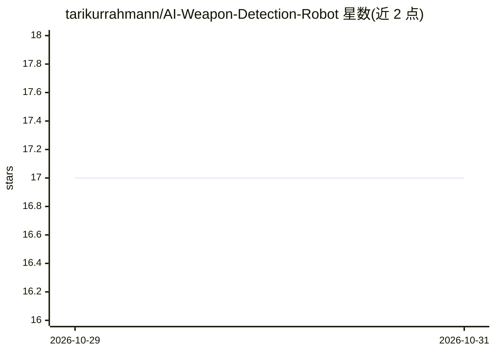

# tarikurrahmann/AI-Weapon-Detection-Robot

⭐ 17 · Python · MIT · 推送 2026-10-11 · [GitHub](https://github.com/tarikurrahmann/AI-Weapon-Detection-Robot) · 个人维护

**浏览器武器检测仪表盘，可选 Arduino 小车/机械臂控制**

Python/Flask 应用：Linux 主机上经 V4L2 USB 摄像头或树莓派 Picamera2 采集视频，用 Ultralytics YOLO 模型（优先 ONNX）做武器与人员检测，默认每 4 帧推理一次，生成标注 MJPEG 流推送到浏览器仪表盘；按框重叠规则推导 person/armed person/military personnel 标签，告警时保存快照并提供 CSV 事件导出（内存中限 200 条）。可选通过串口连接 Arduino 手动操控小车与机械臂，检测不会自动触发运动。面向学习、原型与受监督实验，非认证安防产品；目标运行平台为 Linux/树莓派 OS，Windows 摄像头采集路径未实现。

## 筛选速览

| 维度 | 判定 | 备注 |
|---|---|---|
| AI 角色 | `ai-native` | 本体是模型或模型工具 |
| 许可风险 | `permissive` | MIT |
| 部署形态 | `library` | 以包/库形式分发 |
| 模型依赖 | — | README 未给出锁定关系 |
| 硬件要求 | — | 无带数字的原话,不猜 |
| 安装摩擦 | `low` | 无编译、无系统依赖或容器化 |
| 成熟度 | — | 结构信号不足 |

## 能力要点

- YOLO（ONNX/PyTorch）武器与人员检测，MJPEG 流式浏览器仪表盘
- 框重叠推导 armed person / military personnel 标签（实验性，非身份判定）
- 告警事件快照保存与 CSV 导出，事件队列内存限 200 条
- 可选 Arduino 串口控制小车与机械臂，检测与运动控制相互独立

## 适用场景

- 在 Linux 主机上搭建实时的武器/人员摄像头检测演示
- 结合 Arduino 平台做机器人与计算机视觉的学习原型
- 通过浏览器远程查看标注视频流并导出告警事件记录

## 场景标签

`目标检测` `网络安全` · 领域:学习与行业

## 证据(README 行号)

> L17: AI Weapon Detection Robot combines camera-based object detection with a web dashboard and an optional Arduino-contr
> L50: 3. It selects the ONNX model when the ONNX file exists; otherwise, it selects the PyTorch file.

## 星数曲线

2026-10-29 17 → 2026-10-31 17（+0）

---
*卡片 v1 · prompt 1.4 · 生成 2026-10-29 · 置信度 high · 依据 README sha `c210ef8711fd` · [字段定义](../../DATASET.md)*
