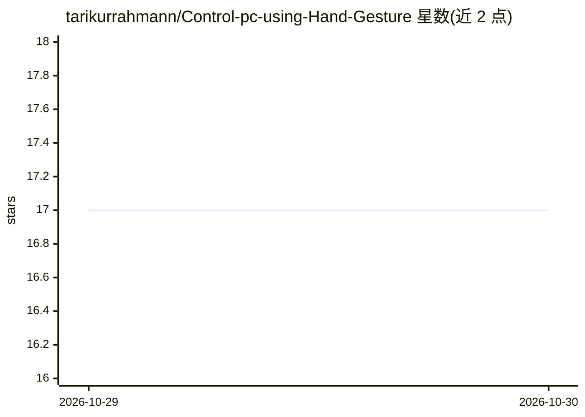

# tarikurrahmann/Control-pc-using-Hand-Gesture

⭐ 17 · Python · MIT · 推送 2026-07-17 · [GitHub](https://github.com/tarikurrahmann/Control-pc-using-Hand-Gesture) · 个人维护

**用摄像头手部手势控制 PC 鼠标、滚动与系统功能的 Python 应用**

基于 Python、OpenCV 与 MediaPipe 的纯软件手势控制系统：通过摄像头实时识别手部关键点，将食指移动映射为光标、拇指+食指捏合触发左键、拇指+中指捏合触发右键、双指手势进入滚动模式，并可控制音量、亮度等系统功能。包含物理平滑（惯性/加速度）、抖动过滤、HUD 实时面板、捏合 0.25 秒防误触与握拳即暂停等安全机制。需 Python 3.8+、摄像头并下载 hand_landmarker.task 模型，作者标注为作品集演示项目。

## 筛选速览

| 维度 | 判定 | 备注 |
|---|---|---|
| AI 角色 | `ai-native` | 本体是模型或模型工具 |
| 许可风险 | `permissive` | MIT |
| 部署形态 | `library` | 以包/库形式分发 |
| 模型依赖 | — | README 未给出锁定关系 |
| 硬件要求 | — | 无带数字的原话,不猜 |
| 安装摩擦 | `low` | 无编译、无系统依赖或容器化 |
| 成熟度 | — | 结构信号不足 |

## 能力要点

- 食指移动控制光标、捏合手势实现左右键点击
- 双指手势切换垂直滚动，握拳进入暂停安全态
- 物理平滑（惯性/加速度）与抖动过滤提升光标稳定性
- HUD 实时显示模式、FPS 与识别到的手势

## 适用场景

- 无物理外设条件下用摄像头手势操作鼠标与滚动
- 通过手势调节音量、亮度等系统功能
- 体验计算机视觉人机交互的演示项目

## 场景标签

 · 领域:人机交互/计算机视觉应用

## 证据(README 行号)

> L3: A professional, software-only solution to control your PC mouse, scrolling, and system features using real-time hand
> L61: * **Pattern**: Raise **Index Finger** ONLY. Keep other fingers curled.

## 星数曲线

2026-10-29 17 → 2026-10-30 17（+0）

---
*卡片 v1 · prompt 1.4 · 生成 2026-10-29 · 置信度 high · 依据 README sha `92651ab0229e` · [字段定义](../../DATASET.md)*
