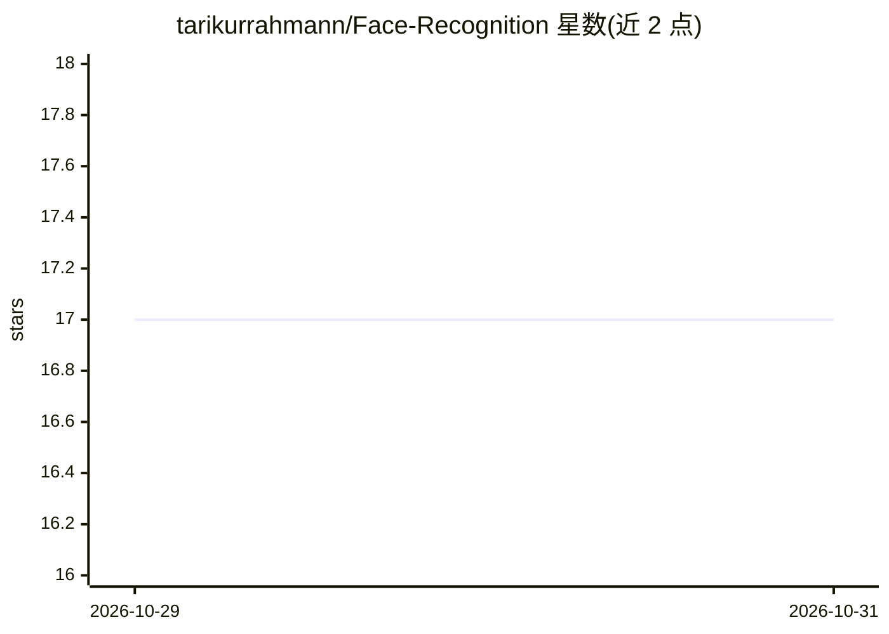

# tarikurrahmann/Face-Recognition

⭐ 17 · Python · MIT · 推送 2026-09-29 · [GitHub](https://github.com/tarikurrahmann/Face-Recognition) · 个人维护

**Python 人脸识别 demo：Haar 级联检测 + LBPH 识别并标注输出**

用 Python 实现的人脸识别演示项目：读取 train/ 目录中每人一张训练图，以文件名作为标签训练 LBPH 识别器，对 test/test.jpg 做人脸检测与身份识别，生成带矩形框和标签的 output.jpg。提供两条路径：默认的 OpenCV-only 方案仅需 opencv-python 与 numpy、无需编译 C++ 扩展；可选 face_recognition（依赖 dlib）方案需 Visual Studio Build Tools 与 CMake 或 conda 预编译包。限制：依赖图像清晰、正脸，识别为 Unknown 时需增加训练图或调阈值。

## 筛选速览

| 维度 | 判定 | 备注 |
|---|---|---|
| AI 角色 | `ai-native` | 本体是模型或模型工具 |
| 许可风险 | `permissive` | MIT |
| 部署形态 | `library` | 以包/库形式分发 |
| 模型依赖 | — | README 未给出锁定关系 |
| 硬件要求 | — | 无带数字的原话,不猜 |
| 安装摩擦 | `medium` | 含编译或系统依赖之一 |
| 成熟度 | — | 结构信号不足 |

## 能力要点

- Haar 级联人脸检测 + LBPH 识别器训练与识别
- 默认路径仅需 opencv-python 与 numpy，无原生编译
- 输出带矩形框与标签的标注图像 output.jpg
- 可选 face_recognition（dlib）路径与 conda 安装方式

## 适用场景

- 我想用少量人脸照片快速搭建一个识别 demo
- 学习 OpenCV Haar 级联与 LBPH 识别器的工作流程
- 对比 dlib 方案与 OpenCV-only 方案的安装成本

## 场景标签

`人脸识别` · 领域:感知与多模态

## 证据(README 行号)

> L5: This is a simple face recognition demo written in Python. It detects faces in an input image and attempts to identif
> L70: - Detects faces in a test image using Haar cascades.
> L71: - Trains an LBPH face recognizer from images in `train/`.

## 星数曲线

2026-10-29 17 → 2026-10-31 17（+0）

---
*卡片 v1 · prompt 1.4 · 生成 2026-10-29 · 置信度 high · 依据 README sha `6325f3455d74` · [字段定义](../../DATASET.md)*
