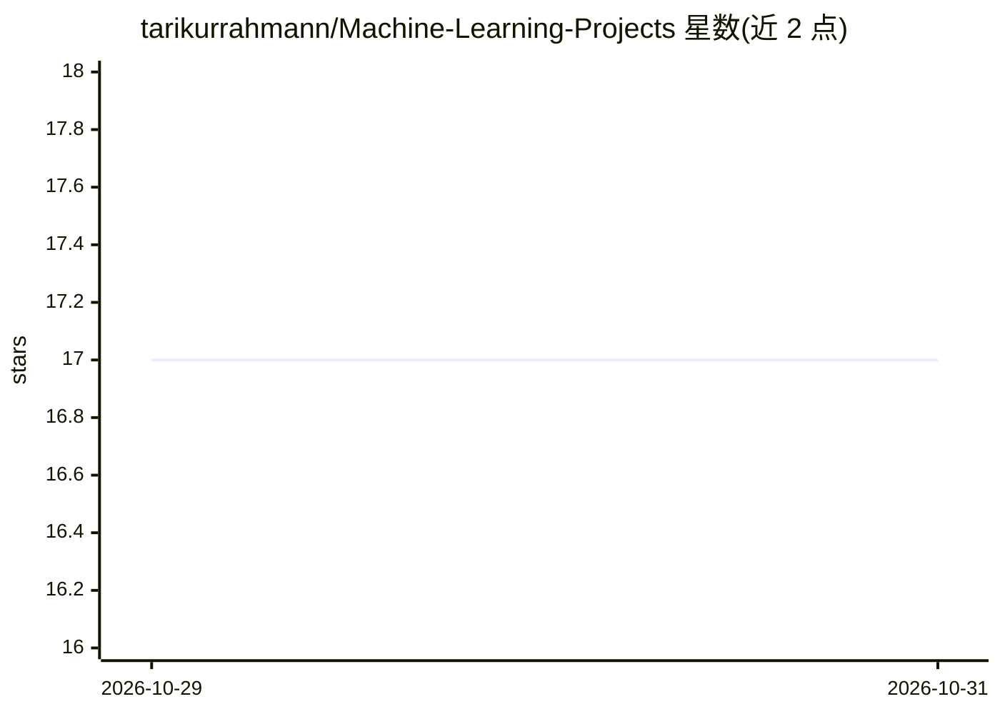

# tarikurrahmann/Machine-Learning-Projects

⭐ 17 · HTML · 推送 2026-09-30 · [GitHub](https://github.com/tarikurrahmann/Machine-Learning-Projects) · 个人维护

**26 个端到端机器学习项目合集，覆盖医疗、CV、NLP 等领域**

个人维护的机器学习项目作品集：收录 26 个端到端项目，分属医疗 AI、计算机视觉、经典 ML、NLP 对话、时间序列与地理空间 6 个类别，难度标注初/中/高级。技术栈包括 scikit-learn、TensorFlow、Keras、PyTorch、OpenCV、XGBoost 等；其中 5 个以 Flask Web 应用部署，3 个为 Tkinter GUI 应用，其余为 Jupyter Notebook。统一的项目目录结构（data/README/requirements），支持 git clone 本地运行及 Heroku 部署，MIT 许可，接受社区新增项目贡献。

## 筛选速览

| 维度 | 判定 | 备注 |
|---|---|---|
| AI 角色 | `ai-native` | 本体是模型或模型工具 |
| 许可风险 | `none` | — |
| 部署形态 | `None` |  |
| 模型依赖 | — | README 未给出锁定关系 |
| 硬件要求 | — | 无带数字的原话,不猜 |
| 安装摩擦 | `low` | 无编译、无系统依赖或容器化 |
| 成熟度 | — | 结构信号不足 |

## 能力要点

- 26 个项目按 6 个领域分类并标注难度与形态（Web/GUI/Notebook）
- 技术栈覆盖 scikit-learn、TensorFlow、Keras、PyTorch、XGBoost、OpenCV
- 5 个项目提供 Flask Web 部署、3 个提供 Tkinter GUI 应用
- 统一项目结构，提供 Heroku 部署流程与贡献指南

## 适用场景

- 学习从数据处理到模型训练再到部署的完整 ML 流程
- 寻找医疗影像、计算机视觉、时间序列等领域的参考实现
- 挑选适合自身水平的入门/进阶 ML 练手项目

## 场景标签

`教程课程` · 领域:学习与行业

## 证据(README 行号)

> L15:  A curated portfolio of 26 end-to-end machine learning projects — spanning healthcare AI, real-time computer vision
> L39: |**Brain Tumor Detection**|Detects tumors in MRI scans using a CNN. Upload a scan and get a real-time prediction.|P

## 星数曲线

2026-10-29 17 → 2026-10-31 17（+0）

---
*卡片 v1 · prompt 1.4 · 生成 2026-10-29 · 置信度 high · 依据 README sha `396b65ddf8ee` · [字段定义](../../DATASET.md)*
