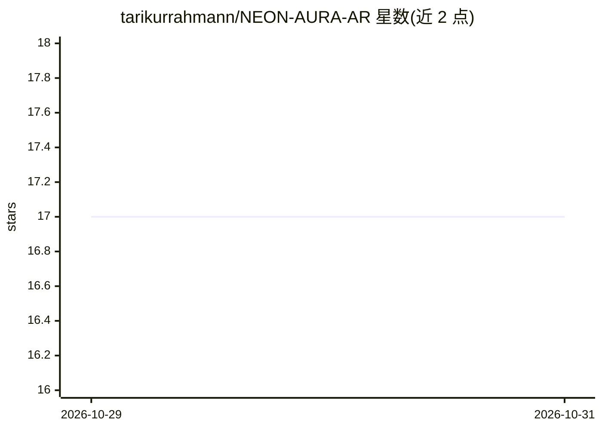

# tarikurrahmann/NEON-AURA-AR

⭐ 17 · HTML · MIT · 推送 2026-10-03 · [GitHub](https://github.com/tarikurrahmann/NEON-AURA-AR) · 个人维护

**浏览器端手势追踪驱动的霓虹 AR 视觉体验，面向创意展示**

纯 HTML/CSS/JavaScript 实现的网页端增强现实体验：通过摄像头接入 MediaPipe Hands 模型实时检测双手各 21 个关键点，识别捏合、张开、握拳、指向、胜利手势与双手靠拢等手势，驱动粒子系统、光晕与拖尾等霓虹视觉效果；结合 Web Audio API 依据手势与手部位置合成音效与背景音。提供 7 种可切换视觉主题，支持桌面与移动浏览器，本地处理摄像头画面，需联网加载 CDN 上的 MediaPipe 库。适用场景包括互动艺术装置、音乐可视化与活动娱乐。

## 筛选速览

| 维度 | 判定 | 备注 |
|---|---|---|
| AI 角色 | `ai-native` | 本体是模型或模型工具 |
| 许可风险 | `permissive` | MIT |
| 部署形态 | `library` | 以包/库形式分发 |
| 模型依赖 | — | README 未给出锁定关系 |
| 硬件要求 | `cpu-ok` | |
| 安装摩擦 | `low` | 无编译、无系统依赖或容器化 |
| 成熟度 | — | 结构信号不足 |

## 能力要点

- MediaPipe 实时双手追踪（每手 21 个关键点），仅需摄像头
- 6 类手势识别（捏合/张开/握拳/指向/胜利/双手靠拢）驱动粒子与音效
- Web Audio API 手势触发与位置控制的实时音频合成
- 7 种视觉主题（Rainbow/Cyberpunk/Lava/Ocean/Galaxy/Forest/Sunset）

## 适用场景

- 美术馆或展会的互动艺术装置
- 演出、DJ 场景的实时音乐可视化
- 学习手势交互与创意编程的 Web 开发项目

## 场景标签

 · 领域:创意技术/互动媒体

## 证据(README 行号)

> L21: **NEON AURA AR** is a cutting-edge browser-based augmented reality experience that transforms your webcam into an i
> L226: - Google's hand detection ML model

## 星数曲线

2026-10-29 17 → 2026-10-31 17（+0）

---
*卡片 v1 · prompt 1.4 · 生成 2026-10-29 · 置信度 mid · 依据 README sha `6cdcd41ea723` · [字段定义](../../DATASET.md)*
