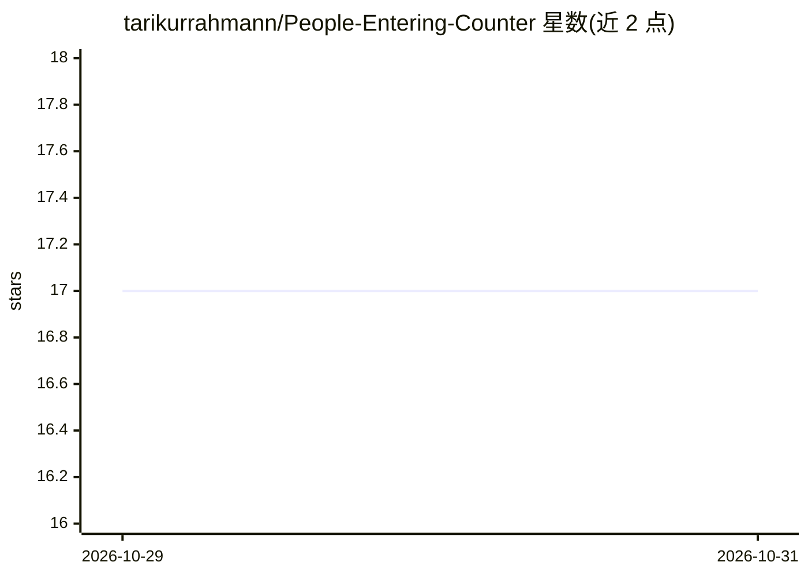

# tarikurrahmann/People-Entering-Counter

⭐ 17 · Python · MIT · 推送 2026-07-24 · [GitHub](https://github.com/tarikurrahmann/People-Entering-Counter) · 个人维护

**计算机视觉进出人数计数器：检测并统计穿越虚拟线的人流**

基于 YOLOv8 检测与目标跟踪逻辑的实时人流计数系统：在画面中设定一条水平虚拟边界线，为每个检测到的行人分配唯一 ID 并跟踪其中心 Y 轨迹，区分 IN 与 OUT 方向并实时累计计数，结果展示在可视化仪表板上。视频源支持视频文件，缺失时自动回退到摄像头输入。技术栈为 Python 3.12+、OpenCV、Ultralytics YOLOv8 与 Supervision，克隆源码安装依赖后单脚本运行。

## 筛选速览

| 维度 | 判定 | 备注 |
|---|---|---|
| AI 角色 | `ai-native` | 本体是模型或模型工具 |
| 许可风险 | `permissive` | MIT |
| 部署形态 | `library` | 以包/库形式分发 |
| 模型依赖 | — | README 未给出锁定关系 |
| 硬件要求 | — | 无带数字的原话,不猜 |
| 安装摩擦 | `low` | 无编译、无系统依赖或容器化 |
| 成熟度 | — | 结构信号不足 |

## 能力要点

- 方向性越线检测，区分 IN 与 OUT 计数
- 唯一对象 ID 与中心 Y 轨迹跟踪
- 实时可视化 IN/OUT 计数仪表板
- 视频文件/摄像头自动回退切换

## 适用场景

- 商铺或场馆统计出入口客流
- 占用人数与人群监控
- 智能安防场景的进出检测

## 场景标签

`目标检测` · 领域:感知与多模态

## 证据(README 行号)

> L25: `people_entering_counter` tracks individuals crossing a virtual boundary line and computes live IN and OUT tallies 
> L42: - Ultralytics YOLOv8

## 星数曲线

2026-10-29 17 → 2026-10-31 17（+0）

---
*卡片 v1 · prompt 1.4 · 生成 2026-10-29 · 置信度 high · 依据 README sha `94ec85a53026` · [字段定义](../../DATASET.md)*
