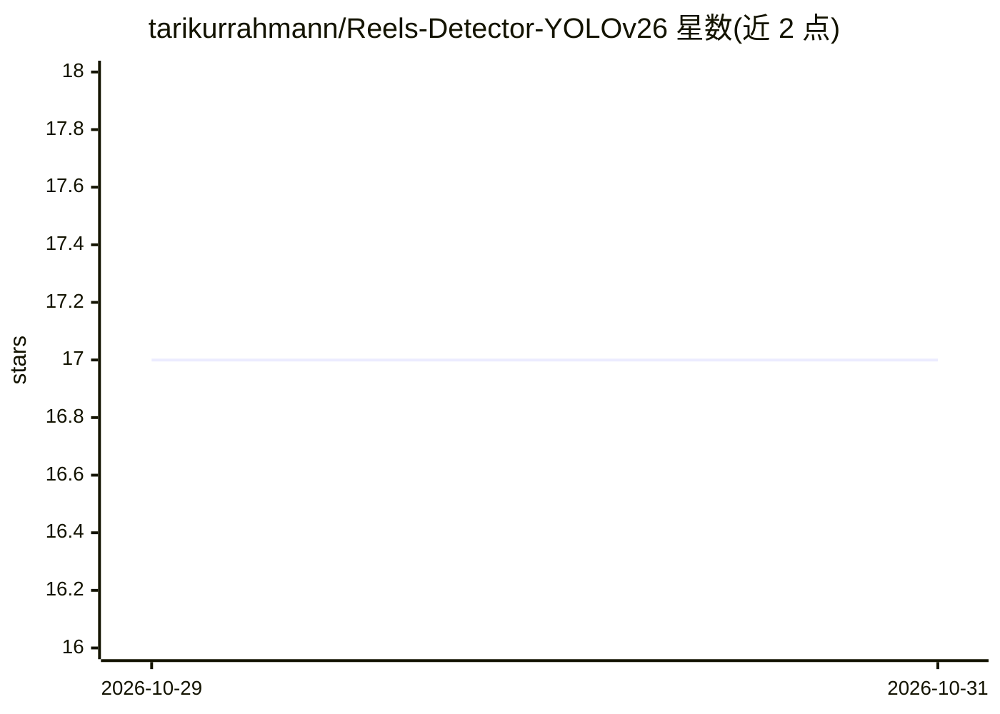

# tarikurrahmann/Reels-Detector-YOLOv26

⭐ 17 · Python · MIT · 推送 2026-07-24 · [GitHub](https://github.com/tarikurrahmann/Reels-Detector-YOLOv26) · 个人维护

**桌面屏幕监控工具：AI 检测手机/电视等分心物并弹窗报警**

基于 YOLO11 与 OpenCV 的 Python 桌面屏幕监控系统：用 mss 持续截取显示器画面，检测手机、屏幕、遥控器等分心对象及可疑窗口标题，识别多人视频画面模式；检测到分心时播放声音并在 Tkinter GUI 弹出带“Back to Work”按钮的报警窗口。终端面板显示运行时长、扫描次数、分心百分比与最近警报。面向希望在工作时屏蔽短视频等干扰的个人用户，Windows 环境以 PowerShell 命令运行，需 Python 3.12+。

## 筛选速览

| 维度 | 判定 | 备注 |
|---|---|---|
| AI 角色 | `ai-native` | 本体是模型或模型工具 |
| 许可风险 | `permissive` | MIT |
| 部署形态 | `library` | 以包/库形式分发 |
| 模型依赖 | — | README 未给出锁定关系 |
| 硬件要求 | — | 无带数字的原话,不猜 |
| 安装摩擦 | `low` | 无编译、无系统依赖或容器化 |
| 成熟度 | — | 结构信号不足 |

## 能力要点

- mss 高速连续桌面截屏
- 基于 YOLO 的分心对象检测（手机/屏幕/遥控器/可疑窗口标题）
- GUI 弹窗报警（声音 + “Back to Work”按钮）
- 终端状态面板显示运行时长、扫描数与分心百分比

## 适用场景

- 工作或学习时自动检测并提醒放下手机等分心物
- 监控自己桌面上的短视频/多屏内容使用情况
- 查看分心占比统计以了解专注状况

## 场景标签

`目标检测` · 领域:感知与多模态

## 证据(README 行号)

> L25: `Reels_detector_yolov26` captures desktop monitor frames, flags distraction objects like cellphones and TVs, identi
> L31: - 🧠 **AI-based distraction detection rules**

## 星数曲线

2026-10-29 17 → 2026-10-31 17（+0）

---
*卡片 v1 · prompt 1.4 · 生成 2026-10-29 · 置信度 high · 依据 README sha `408ba564186b` · [字段定义](../../DATASET.md)*
