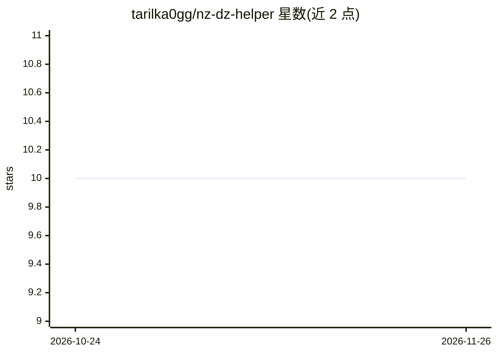

# tarilka0gg/nz-dz-helper

⭐ 10 · Python · 推送 2026-10-05 · [GitHub](https://github.com/tarilka0gg/nz-dz-helper) · 个人维护

**给乌克兰家长的 Telegram 机器人：读取 nz.ua 作业并生成 LLM 解答**

Python 编写的 Telegram 机器人，登录家长的 nz.ua 账户抓取学生日记，用关键词规则分类作业类型：课本习题从教材 PDF（可选 GDZ 扫描件加 OCR）中定位题目原文，经 LLM（默认 Groq，理科用 Gemini）生成讲解；作文/短文类直接生成文本；组织性任务仅给简短建议或跳过。支持按科目配置 provider 与 429 限流自动回退，Telegram 访问用 user_id 白名单限制，并声明个人数据仅留在本机。作者自述为单账户可用的原型，机器人与抓取部分无测试覆盖。

## 筛选速览

| 维度 | 判定 | 备注 |
|---|---|---|
| AI 角色 | `ai-native` | 本体是模型或模型工具 |
| 许可风险 | `none` | — |
| 部署形态 | `library` | 以包/库形式分发 |
| 模型依赖 | locked-api |  |
| 硬件要求 | — | 无带数字的原话,不猜 |
| 安装摩擦 | `low` | 无编译、无系统依赖或容器化 |
| 成熟度 | `idea` | |

## 能力要点

- 登录 nz.ua 抓取学生日记并解析作业内容
- 从教材 PDF 定位习题原文，可选 GDZ 扫描 + OCR 比对
- Groq 默认、Gemini 理科的 provider 配置与 429 自动回退
- Telegram 访问限 allowlist，个人数据保留在本机

## 适用场景

- 家长自动获取孩子当日/当周作业并生成讲解
- 手动指定科目和习题号获取解答
- 在本地运行以保留子女日记数据的隐私

## 场景标签

`文档问答` · 领域:知识与检索

## 证据(README 行号)

> L3: Telegram-бот, який тягне щоденник дитини з nz.ua (Yii2 SSR-портал "Нові
> L26: 4. LLM (Groq за замовчуванням, Gemini для точних наук) пише пояснення чи

## 星数曲线

2026-10-24 10 → 2026-11-26 10（+0）

---
*卡片 v1 · prompt 1.4 · 生成 2026-11-19 · 置信度 high · 依据 README sha `b76b905a3b39` · [字段定义](../../DATASET.md)*
