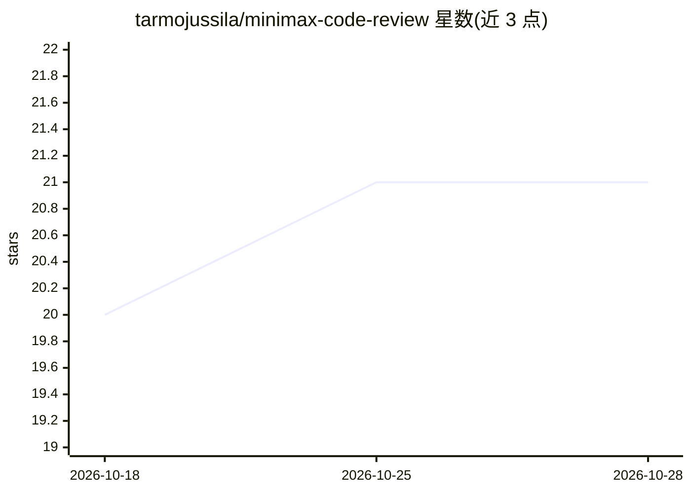

# tarmojussila/minimax-code-review

⭐ 21 · JavaScript · MIT · 推送 2026-09-16 · [GitHub](https://github.com/tarmojussila/minimax-code-review) · 个人维护

**用 MiniMax 模型做 GitHub PR 代码审查的 Action**

面向 GitHub 仓库的 Actions 集成：在 pull request 上调用 MiniMax 模型（默认 MiniMax-M2.5）生成代码审查评论，覆盖 bug 检测与改进建议。通过 workflow 文件引用该 action（tarmojussila/minimax-code-review@v0.4.1），以 GitHub secret 配置 MiniMax API key；可自定义模型、system prompt、审查者名称、排除文件模式与 diff 字符上限，也可将模型等参数改为 Actions variables 管理。MIT 许可。

## 筛选速览

| 维度 | 判定 | 备注 |
|---|---|---|
| AI 角色 | `ai-native` | 本体是模型或模型工具 |
| 许可风险 | `permissive` | MIT |
| 部署形态 | `None` |  |
| 模型依赖 | — | README 未给出锁定关系 |
| 硬件要求 | — | 无带数字的原话,不猜 |
| 安装摩擦 | `low` | 无编译、无系统依赖或容器化 |
| 成熟度 | — | 结构信号不足 |

## 能力要点

- GitHub Actions 形式接入，PR 触发自动审查评论
- 默认使用 MiniMax-M2.5，模型可自定义
- 支持自定义 system prompt（如安全聚焦审查）
- EXCLUDE_PATTERNS 排除 lock 文件等，MAX_DIFF_CHARS 限制 diff 长度

## 适用场景

- PR 合并前自动获得 AI 代码审查评论
- 以安全为导向的代码变更审查
- 按团队编码规范定制审查提示词

## 场景标签

 · 领域:开发工具/CI-CD

## 证据(README 行号)

> L3: AI-powered GitHub Pull Request code review using MiniMax models. Automatic PR comments, bug detection, and improveme
> L27: |`MINIMAX_API_KEY`|Yes|—|Your MiniMax API key|

## 星数曲线

2026-10-18 20 → 2026-10-28 21（+1）

---
*卡片 v1 · prompt 1.4 · 生成 2026-10-28 · 置信度 high · 依据 README sha `0b9288ac2611` · [字段定义](../../DATASET.md)*
