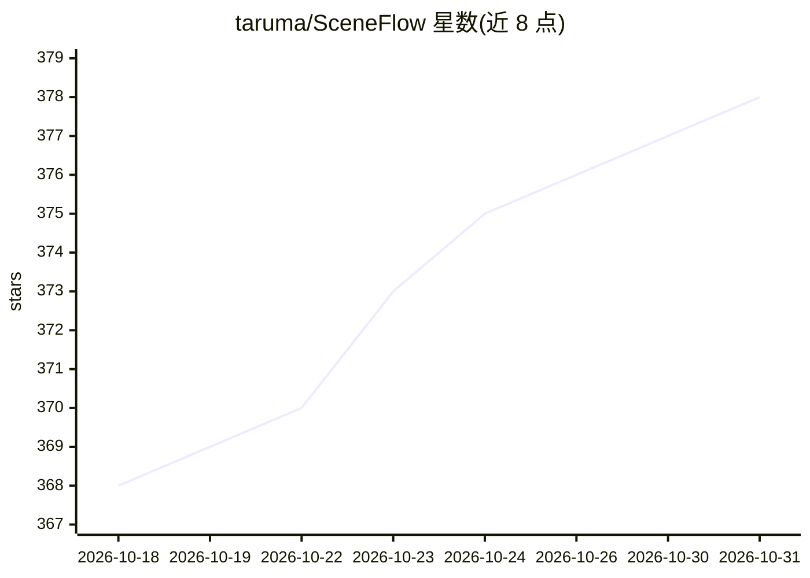

# taruma/SceneFlow

⭐ 378 · TypeScript · MIT · 推送 2026-10-25 · [GitHub](https://github.com/taruma/SceneFlow) · [官网](https://sceneflow.taruma.my.id) · 个人维护

**为 AI 影像创作者做剧本-视频同步与提示词遵循度分析的工具**

面向 AI 电影制作者的剧本-视频同步工具：将剧本文本分段（cue）与视频时间戳关联，播放时高亮当前台词/动作，支持 8 类彩色 cue 标注、多轨时间线与三面板编辑工作台。核心用于评估 AI 视频模型对提示词的还原度：定位遗漏的提示元素、镜头偏移与连贯性偏差。cue 可手动创建，也可借助外部多模态模型（如 Gemini）生成，内置同步提示词与 JSON Schema。项目以 JSON 文件保存，支持 URL 分享。

## 筛选速览

| 维度 | 判定 | 备注 |
|---|---|---|
| AI 角色 | `ai-ecosystem` | LLM/agent 周边工具 |
| 许可风险 | `permissive` | MIT |
| 部署形态 | `None` |  |
| 模型依赖 | — | README 未给出锁定关系 |
| 硬件要求 | — | 无带数字的原话,不猜 |
| 安装摩擦 | `low` | 无编译、无系统依赖或容器化 |
| 成熟度 | — | 结构信号不足 |

## 能力要点

- 剧本段落与视频时间戳的 cue 级同步，播放时自动跟随高亮
- 提示词遵循度分析：定位遗漏元素、镜头偏移、连贯性偏差
- 内置 Gemini 同步提示词与精简 JSON Schema，用于结构化 cue 生成
- JSON 项目文件，支持保存、版本控制与 URL 分享

## 适用场景

- 检查 AI 生成视频是否落实了剧本中的每个提示元素
- 在带时间线的三面板工作台里手动对齐剧本与视频
- 用 Gemini 等多模态模型批量生成同步 cue 后导入核对

## 场景标签

`模型评测` · 领域:评测与运维

## 证据(README 行号)

> L18: Built for evaluating how AI video models visualize prompt instructions, it supports both traditional **Screenplay f
> L29: - **Adherence Analysis** — Pinpoint missed prompt elements, camera drift, or continuity deviations against the gene

## 星数曲线

2026-10-18 368 → 2026-10-31 378（+10）

---
*卡片 v1 · prompt 1.4 · 生成 2026-10-21 · 置信度 mid · 依据 README sha `2377e8b1d16a` · [字段定义](../../DATASET.md)*
