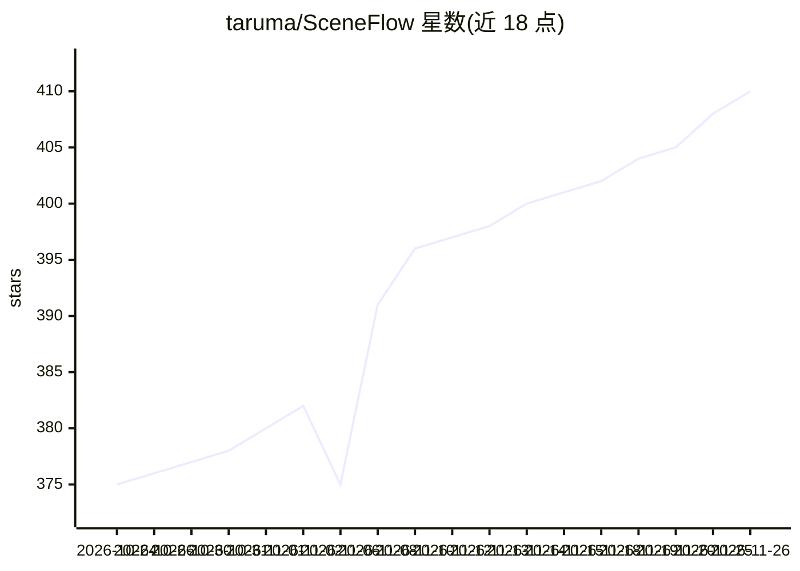

# taruma/SceneFlow

⭐ 410 · TypeScript · MIT · 推送 2026-11-14 · [GitHub](https://github.com/taruma/SceneFlow) · [官网](https://sceneflow.taruma.my.id) · 个人维护

**为 AI 影视创作者同步剧本与视频并评估生成画面**

SceneFlow 是一个将剧本/分镜与视频内容按时间轴同步的工具，实时高亮正在播放的脚本段落，用于评估 AI 视频模型对 prompt 指令的还原程度。支持传统剧本格式与含 5 部分舞台元数据的 Auteur Script 状态驱动格式，提供 8 类颜色编码 cue、多轨时间轴、三面板编辑工作台、 adherence 偏差分析（遗漏元素、镜头漂移、连续性问题）。同步 cue 需手动编写或借助外部多模态模型（如 Gemini）按内置 prompt 与 JSON schema 生成；不提供后台自动提取。项目以 JSON 文件保存、分享与版本管理，提供在线应用。

## 筛选速览

| 维度 | 判定 | 备注 |
|---|---|---|
| AI 角色 | `ai-enhanced` | 去掉 AI 部分产品仍成立 |
| 许可风险 | `permissive` | MIT |
| 部署形态 | `None` |  |
| 模型依赖 | — | README 未给出锁定关系 |
| 硬件要求 | — | 无带数字的原话,不猜 |
| 安装摩擦 | `low` | 无编译、无系统依赖或容器化 |
| 成熟度 | — | 结构信号不足 |

## 能力要点

- 剧本段落与视频时间戳的 cue 级同步，8 类元素类型颜色编码
- 内置 Gemini Sync Prompt 与最小 JSON Schema 用于结构化 cue 生成
- Adherence 分析定位遗漏 prompt 元素、镜头漂移与连续性偏差
- JSON 项目文件可保存、分享（URL 参数）与版本管理

## 适用场景

- 逐段核对 AI 生成的视频画面是否覆盖了 prompt 指令
- 迭代 AI 电影项目时追踪镜头漂移与连续性偏差
- 为剧本段落手动或借助 LLM 制作带时间戳的 cue 表

## 场景标签

 · 领域:影视/创作工具

## 证据(README 行号)

> L16: **SceneFlow** is a tool that syncs scripts and screenplays with video content, letting you see which parts of your 
> L18: Built for evaluating how AI video models visualize prompt instructions, it supports both traditional **Screenplay f
> L20: > **Note on Cue Creation**: SceneFlow does not automatically extract video sync cues in the background. Cues can be

## 星数曲线

2026-10-24 375 → 2026-11-26 410（+35）

---
*卡片 v1 · prompt 1.4 · 生成 2026-11-25 · 置信度 high · 依据 README sha `691ec5d84c4a` · [字段定义](../../DATASET.md)*
