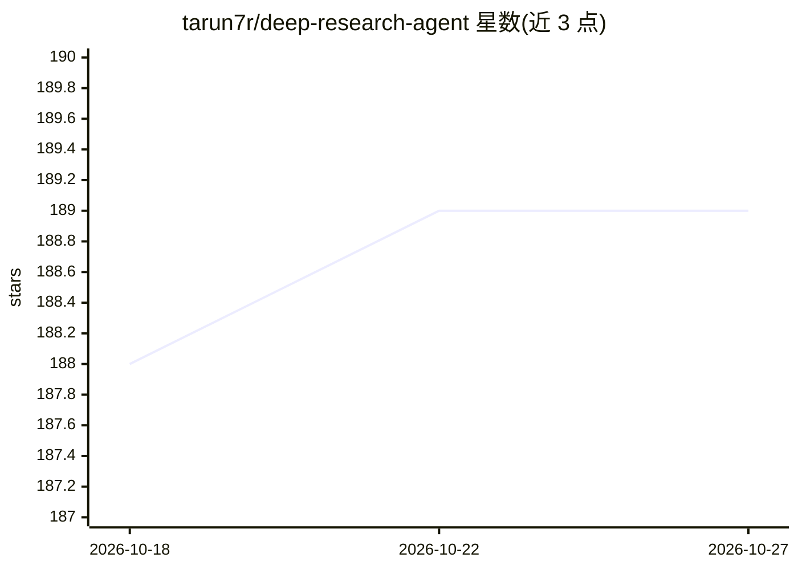

# tarun7r/deep-research-agent

⭐ 189 · Python · MIT · 推送 2026-04-04 · [GitHub](https://github.com/tarun7r/deep-research-agent) · 个人维护

**多智能体自主研究系统：自动检索并生成带引用的研究报告**

基于 LangGraph 与 LangChain 构建的多智能体研究系统，由 ResearchPlanner、ResearchSearcher、ResearchSynthesizer、ReportWriter 四个专职智能体协作：规划 SMART 目标、动态决定检索查询与抽取深度、按域名权威度做 0-100 可信度评分与过滤，最终生成含 APA/MLA/Chicago/IEEE 引用的多格式（Markdown/HTML/TXT）报告。支持本地模型（Ollama、llama.cpp）与云端 API（Gemini、OpenAI），提供 CLI、Chainlit Web 界面与 Python API，并含断路器、检查点恢复与 7 天研究缓存。面向需要自动化文献调研的开发者与研究人员。

## 筛选速览

| 维度 | 判定 | 备注 |
|---|---|---|
| AI 角色 | `ai-native` | 本体是模型或模型工具 |
| 许可风险 | `permissive` | MIT |
| 部署形态 | `None` |  |
| 模型依赖 | local-ok | 支持本地模型 |
| 硬件要求 | — | 无带数字的原话,不猜 |
| 安装摩擦 | `low` | 无编译、无系统依赖或容器化 |
| 成熟度 | — | 结构信号不足 |

## 能力要点

- 四个专职智能体经 LangGraph StateGraph 编排，检索智能体自主决定查询与抽取深度
- 来源可信度 0-100 评分（可信域名/HTTPS 等因子），默认阈值 40 可配置
- 报告含 APA/MLA/Chicago/IEEE 引用，可导出 Markdown/HTML/TXT
- 支持 Ollama/llama.cpp 本地运行与 Gemini/OpenAI 云端 API，提供 SQLite 持久化崩溃恢复

## 适用场景

- 我对一个陌生课题快速生成带引用的调研报告
- 我希望全程用本地模型完成深度检索，不把数据发给云端
- 我需要带实时进度与质量指标的 Web 研究界面

## 场景标签

`多智能体` `科研工具` · 领域:Agent 开发

## 证据(README 行号)

> L7: A production-ready multi-agent autonomous research system built with LangGraph and LangChain. Four specialized agent
> L9: **Supports:** Local models (Ollama, llama.cpp) and Cloud APIs (Google Gemini, OpenAI)
> L74: - Adds proper citations (APA, MLA, Chicago, IEEE)

## 星数曲线

2026-10-18 188 → 2026-10-27 189（+1）

---
*卡片 v1 · prompt 1.4 · 生成 2026-10-22 · 置信度 high · 依据 README sha `6f6ec44a8a6e` · [字段定义](../../DATASET.md)*
