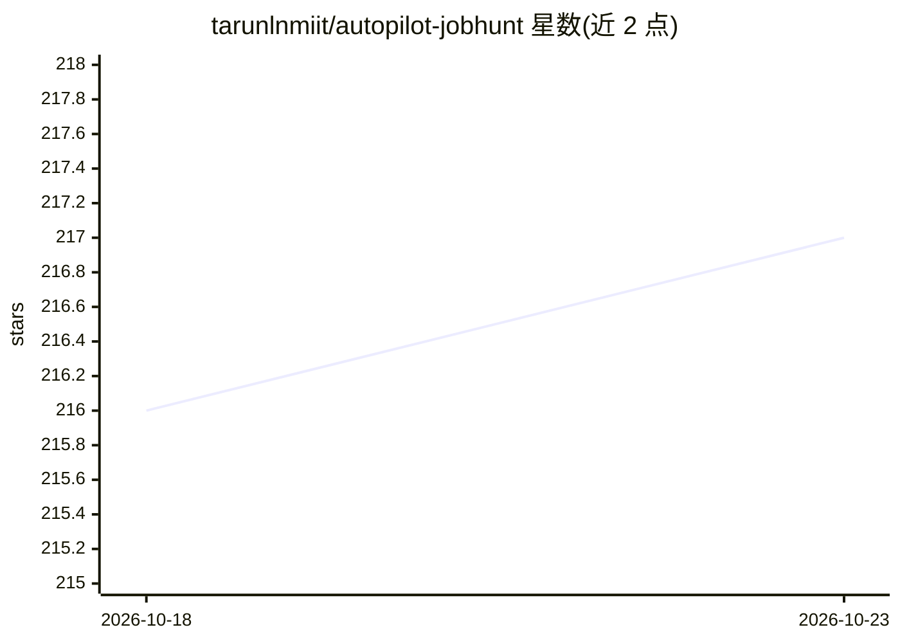

# tarunlnmiit/autopilot-jobhunt

⭐ 217 · Python · MIT · 推送 2026-09-20 · [GitHub](https://github.com/tarunlnmiit/autopilot-jobhunt) · [官网](https://pypi.org/project/autopilot-jobhunt/) · 个人维护

**自动扫描招聘页并按简历打分的求职代理，Telegram 推送**

面向求职者的自动化求职工具：每晚 2:30 通过 TinyFish API 扫描 130+ 公司招聘页，由 LLM 读取完整简历与职位描述给出 0–100 匹配分及一句话理由，达标职位经 Telegram 推送，并可按需生成定制简历要点与求职信草稿（只起草、不代投）。提供独立 CLI 与 MCP server 两种模式，可接入 Claude Code / Claude Desktop。默认 LLM 走 OpenRouter 免费 4 模型回退链，也可切换 Claude CLI 或 Anthropic API；需 Python 3.11+ 与 TinyFish、OpenRouter 的 API key。

## 筛选速览

| 维度 | 判定 | 备注 |
|---|---|---|
| AI 角色 | `ai-native` | 本体是模型或模型工具 |
| 许可风险 | `permissive` | MIT |
| 部署形态 | `library` | 以包/库形式分发 |
| 模型依赖 | locked-api |  |
| 硬件要求 | — | 无带数字的原话,不猜 |
| 安装摩擦 | `low` | 无编译、无系统依赖或容器化 |
| 成熟度 | — | 结构信号不足 |

## 能力要点

- LLM 读取完整简历与职位描述打 0–100 匹配分并给出一句话理由
- 内置 130+ 家欧新及远程友好科技公司的 companies.json 可自行增删
- 默认 OpenRouter 免费 4 模型回退链，自动切换触发限额的模型
- 仅生成申请草稿，用户自行审核提交；提供 MCP server 接入 Claude Code

## 适用场景

- 让工具每晚自动扫描目标公司招聘页，早上在 Telegram 收到匹配职位
- 根据我的简历筛掉不匹配的岗位，只看 60 分以上的
- 对感兴趣岗位一键生成定制简历要点和求职信草稿再人工提交
- 在 Claude Code 会话中用对话驱动扫描、起草和导出

## 场景标签

`网页抓取` `AI 写作` · 领域:效率与自动化

## 证据(README 行号)

> L36:     B --> C["LLM Batch Scorer\n(0–100 fit score)"]
> L38:     C -->|on demand| E["✉️ Cover Letter\n+ Resume Bullets"]

## 星数曲线

2026-10-18 216 → 2026-10-23 217（+1）

---
*卡片 v1 · prompt 1.4 · 生成 2026-10-22 · 置信度 high · 依据 README sha `2e32fcba0811` · [字段定义](../../DATASET.md)*
