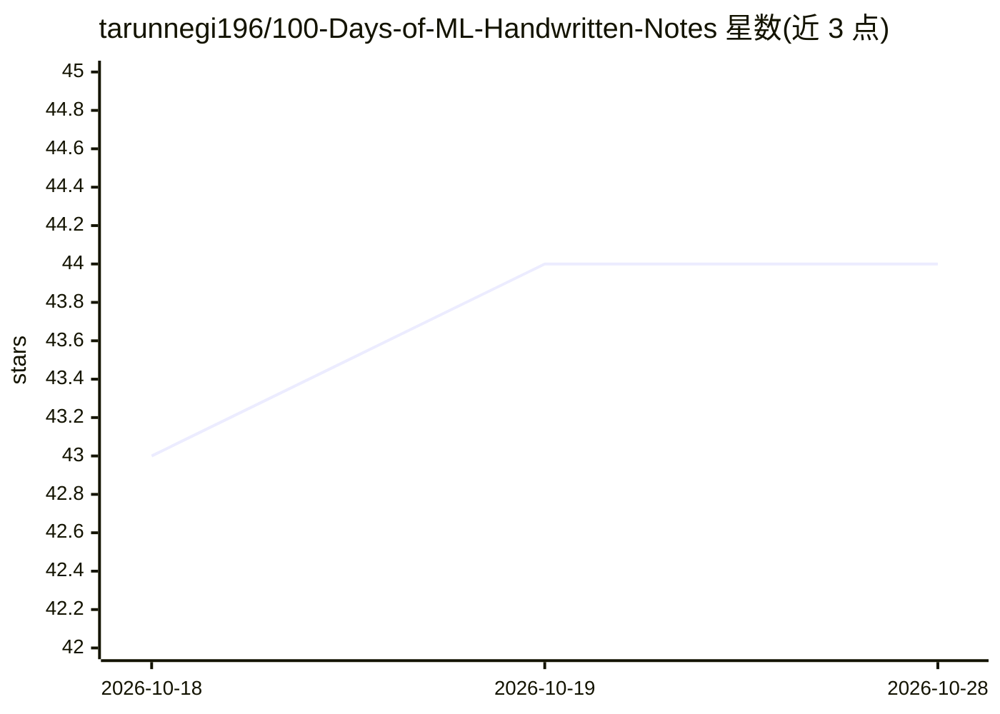

# tarunnegi196/100-Days-of-ML-Handwritten-Notes

⭐ 44 · 推送 2026-01-17 · [GitHub](https://github.com/tarunnegi196/100-Days-of-ML-Handwritten-Notes) · [官网](https://www.youtube.com/playlist?list=PLKnIA16_Rmvbr7zKYQuBfsVkjoLcJgxHH) · 个人维护

**跟学 CampusX 机器学习课程的 50 页手写学习笔记**

作者跟随 CampusX（Nitish Kumar）的『100 Days of Machine Learning』视频课程整理的约 50 页手写笔记，内容非结构化、按课程播放顺序排列，定位为初学者的原始学习笔记，用于跟学与复习概念。仓库以 PDF 形式提供下载，概念性内容署名归于课程作者，声明仅用于教育目的。不含代码、工具或可运行组件。

## 筛选速览

| 维度 | 判定 | 备注 |
|---|---|---|
| AI 角色 | `ai-knowledge` | 知识聚合/清单类 |
| 许可风险 | `none` | — |
| 部署形态 | `None` |  |
| 模型依赖 | — | README 未给出锁定关系 |
| 硬件要求 | — | 无带数字的原话,不猜 |
| 安装摩擦 | `low` | 无编译、无系统依赖或容器化 |
| 成熟度 | — | 结构信号不足 |

## 能力要点

- 约 50 页手写笔记，覆盖 100 天机器学习课程内容
- 按课程播放列表原始顺序组织，标注为非结构化笔记
- 以 PDF 形式提供下载

## 适用场景

- 初学者配合 CampusX 课程跟学与复习概念
- 机器学习入门者快速回顾课程知识点

## 场景标签

`教程课程` · 领域:学习与行业

## 证据(README 行号)

> L3: These are my **50 page handwritten learning notes** from the
> L6: > **Note:** These notes are unstructured and follow the exact order of the playlist.

## 星数曲线

2026-10-18 43 → 2026-10-28 44（+1）

---
*卡片 v1 · prompt 1.4 · 生成 2026-10-25 · 置信度 high · 依据 README sha `cc385a11427e` · [字段定义](../../DATASET.md)*
