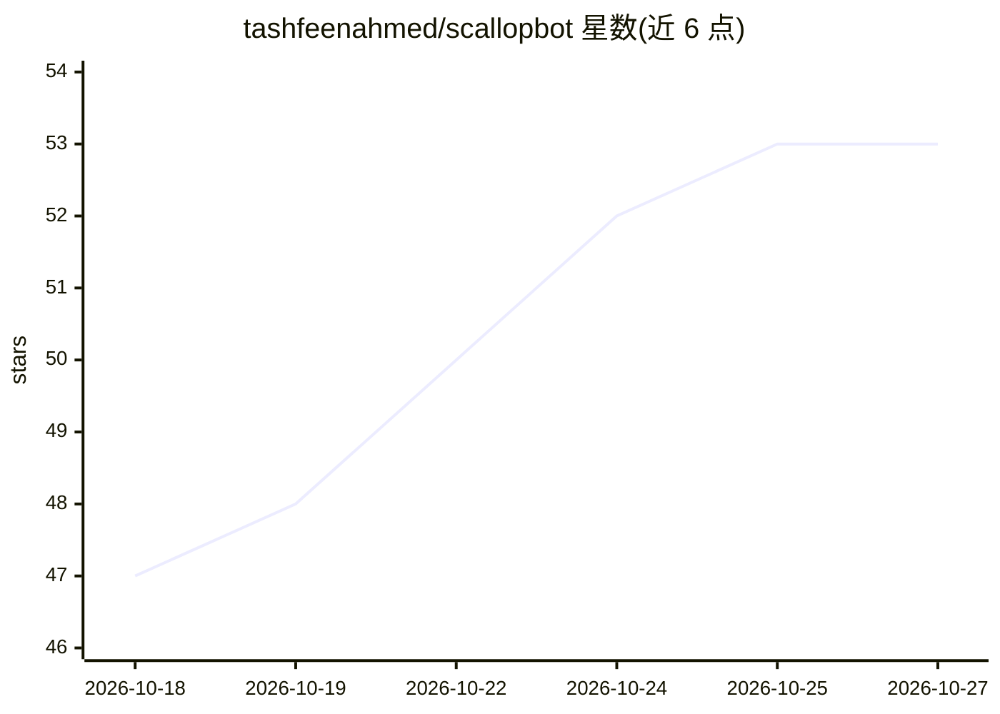

# tashfeenahmed/scallopbot

⭐ 53 · TypeScript · MIT · 推送 2026-10-16 · [GitHub](https://github.com/tashfeenahmed/scallopbot) · [官网](https://scallopbot.com) · 个人维护

**自托管的个人 AI 助手，带生物启发式记忆与自省循环**

运行在用户自己服务器上的 Node.js 个人 AI 代理：通过 Telegram、Web 仪表盘、CLI 及 Discord/Slack 等渠道对话；记忆存储在单个 SQLite 文件中，由后台 gardener 守护进程执行每分钟衰减、约 72 分钟一次审计、夜间两阶段梦周期（NREM 合并、REM 关联探索）与自省。支持 MCP 双向：可消费任意 MCP 服务器，并将自身记忆暴露为 MCP 服务器供 Claude Code、Codex 共享。含成本感知路由、7 个 LLM 供应商故障切换与文件变更前的新鲜上下文复核。安装提供一键脚本、Docker Compose 与源码构建，需 Node.js 24+。

## 筛选速览

| 维度 | 判定 | 备注 |
|---|---|---|
| AI 角色 | `ai-native` | 本体是模型或模型工具 |
| 许可风险 | `permissive` | MIT |
| 部署形态 | `self-host` | docker 或自建部署 |
| 模型依赖 | local-ok | 支持本地模型 |
| 硬件要求 | — | 无带数字的原话,不猜 |
| 安装摩擦 | `low` | 无编译、无系统依赖或容器化 |
| 成熟度 | — | 结构信号不足 |

## 能力要点

- 记忆融合、链接、遗忘的持久演化，BM25+embedding+可选 LLM 重排召回
- MCP 双向：消费任意 MCP 服务器，同时把记忆暴露为 MCP 服务器（memory_store/recall/temporal 三工具）
- 夜间梦周期（NREM 巩固 + REM 关联探索）、AFINN/VADER 情感建模与自省演化
- 成本感知路由与日/月预算控制，声明约每日 0.05–0.10 美元模型开销

## 适用场景

- 在自己服务器上跑一个长期记住我的个人 AI 助手
- 让 Claude Code / Codex 等 MCP 客户端与 Telegram 机器人共享同一份记忆
- 需要定时提醒、主动关怀等自主发消息行为的私人助理

## 场景标签

`AI 助手` `Agent 记忆` · 领域:Agent 开发

## 证据(README 行号)

> L22: ScallopBot is a personal AI agent that runs on your own server. Open-source agents like OpenClaw are good at tool o
> L59: Everything runs in one Node.js process. Messages from any channel go through the gateway to the agent loop, which r

## 星数曲线

2026-10-18 47 → 2026-10-27 53（+6）

---
*卡片 v1 · prompt 1.4 · 生成 2026-10-24 · 置信度 high · 依据 README sha `88d70ed9917b` · [字段定义](../../DATASET.md)*
