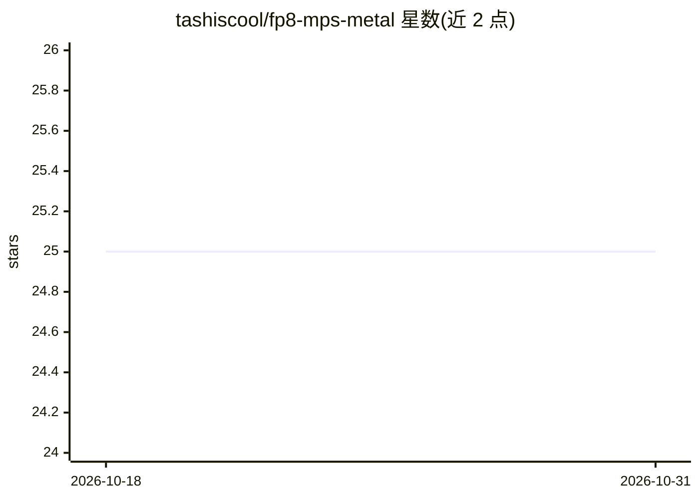

# tashiscool/fp8-mps-metal

⭐ 25 · Python · 推送 2026-02-08 · [GitHub](https://github.com/tashiscool/fp8-mps-metal) · 个人维护

**Apple Silicon MPS 上的 FP8 Metal 计算内核，让 FLUX/SD3.5 可跑**

为 PyTorch MPS 后端补齐 FP8 计算缺口的 Metal GPU 内核库：提供 4 个 kernel（FP8 缩放矩阵乘、SIMD 单 token 推理、反量化、量化），并以 monkey-patch 透明拦截 torch._scaled_mm，使 ComfyUI/diffusers 无需改代码即可加载 FP8 量化模型。面向在 Mac 上运行 FLUX/SD3.5 等扩散模型的开发者；README 另附大量 MPS 与 NVIDIA 差异的排查指南。shader 在运行时经 torch.mps.compile_shader 编译，无需 Xcode；测试环境为 M4 Pro、macOS 26.2、PyTorch 2.10。

## 筛选速览

| 维度 | 判定 | 备注 |
|---|---|---|
| AI 角色 | `ai-ecosystem` | LLM/agent 周边工具 |
| 许可风险 | `none` | — |
| 部署形态 | `None` |  |
| 模型依赖 | — | README 未给出锁定关系 |
| 硬件要求 | — | 无带数字的原话,不猜 |
| 安装摩擦 | `medium` | 含编译或系统依赖之一 |
| 成熟度 | — | 结构信号不足 |

## 能力要点

- 4 个 Metal kernel 覆盖 FP8 量化/反量化/矩阵乘
- monkey-patch 拦截 torch._scaled_mm，ComfyUI/diffusers 零改动接入
- 运行时编译 shader，无需安装 Xcode
- 附 MPS 局限排查指南（量化、显存、小矩阵、LoRA 预合并等）

## 适用场景

- 在 Mac 上运行 FLUX/SD3.5 等 FP8 量化扩散模型时消除 _scaled_mm 报错
- ComfyUI 在 Apple Silicon 上加载 FP8 模型不再崩溃
- 查阅 PyTorch MPS 后端与 NVIDIA CUDA 的能力差异及应对方法

## 场景标签

`模型量化` `推理引擎` · 领域:训练与推理

## 证据(README 行号)

> L5: If you've tried to run FLUX, SD3.5, or any FP8-quantized model on your Mac and hit cryptic errors like `"does not ha
> L36: And a monkey-patch that transparently intercepts `torch._scaled_mm` so ComfyUI/diffusers work without code changes.

## 星数曲线

2026-10-18 25 → 2026-10-31 25（+0）

---
*卡片 v1 · prompt 1.4 · 生成 2026-10-26 · 置信度 high · 依据 README sha `46aa7ee38e04` · [字段定义](../../DATASET.md)*
