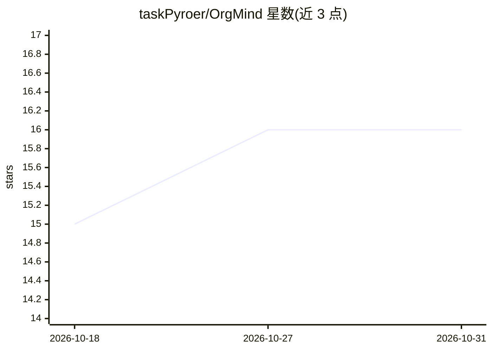

# taskPyroer/OrgMind

⭐ 16 · TypeScript · MulanPSL-2.0 · 推送 2026-02-26 · [GitHub](https://github.com/taskPyroer/OrgMind) · [官网](https://www.bilibili.com/video/BV1Vqw3zyEZi) · 个人维护 · 中文 README

**企业组织智能系统：OA 管理+RAG 问答+AI 考试+权限管理**

前后端分离的组织管理系统：前端 Ant Design Pro (React)，后端 FastAPI，数据层 PostgreSQL+pgvector。功能含 OA 组织架构与薪酬管理、RAG 知识库问答（文档上传-切片-BGE-M3 向量化-检索重排-LLM 生成）、AI 出题与在线考试（自动评分、防作弊）、RBAC 权限管理与员工门户。模型服务基于 OpenAI 接口协议，默认接入长亭百智云（deepseek-v3/bge-m3/bge-reranker-v2-m3），可通过 .env 切换 Azure/通义/Ollama。部署需 Python 3.11+、Node.js 20+、PostgreSQL 15+ 并安装 vector 扩展。

## 筛选速览

| 维度 | 判定 | 备注 |
|---|---|---|
| AI 角色 | `ai-native` | 本体是模型或模型工具 |
| 许可风险 | `viral` | MulanPSL-2.0 |
| 部署形态 | `library` | 以包/库形式分发 |
| 模型依赖 | local-ok | 支持本地模型 |
| 硬件要求 | — | 无带数字的原话,不猜 |
| 安装摩擦 | `low` | 无编译、无系统依赖或容器化 |
| 成熟度 | — | 结构信号不足 |

## 能力要点

- RAG 流水线：LangChain 切片 + bge-m3 向量化 + Rerank 重排 + LLM 生成
- AI 出题与自动评分：客观题即时评分、主观题 AI 辅助评分、倒计时与切屏检测
- RBAC 细粒度权限：菜单、按钮级别配置与前端路由鉴权
- 模型服务基于 OpenAI 协议封装，可切换 Azure/通义/Ollama

## 适用场景

- 企业内部知识库问答与文档管理
- 基于知识库自动生成试卷并组织在线考试
- 管理部门、岗位、职员与薪酬结构并做权限管控

## 场景标签

`文档问答` `RAG` · 领域:知识与检索

## 证据(README 行号)

> L9: OrgMind 是一个集成了 **OA 组织架构管理**、**RAG 知识库问答**、**AI 智能考试** 与 **企业级权限管理** 的现代化组织智能系统。
> L45: |**RAG 知识库** (RAG)|文档上传、解析、切片、向量化、智能问答|LangChain TextSplitter, Embedding (BGE-M3), Rerank, Vector Search|
> L75: 5. **检索与生成**: 用户提问 → 生成问题向量 → 数据库相似度检索 → Rerank 重排序 → LLM 生成回答

## 星数曲线

2026-10-18 15 → 2026-10-31 16（+1）

---
*卡片 v1 · prompt 1.4 · 生成 2026-10-30 · 置信度 high · 依据 README sha `3e02cc2bc15d` · [字段定义](../../DATASET.md)*
