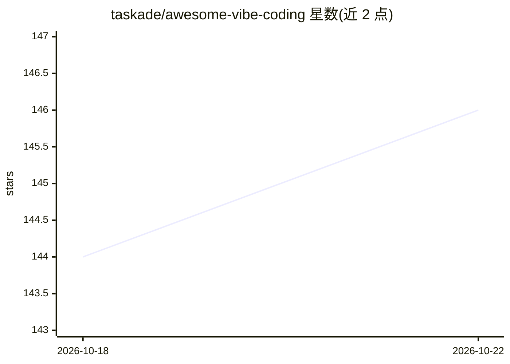

# taskade/awesome-vibe-coding

⭐ 143 · CC-BY-4.0 · 推送 2026-09-11 · [GitHub](https://github.com/taskade/awesome-vibe-coding) · [官网](https://www.taskade.com/genesis) · 组织维护

**vibe coding 工具与资源策展清单（350+ 条）**

由 Taskade 维护的 awesome 清单，收录 350+ 个通过自然语言提示构建软件的工具与资源，覆盖 AI 应用生成器、AI 代码编辑器、CLI 工具、自主编码 agent、网站生成器、MCP、安全检查与学习资源等类别；条目附定价模型、适用人群与一句描述，并要求收录条目具备有效 URL、许可证、文档与近 90 天提交。README 中含较多 Taskade Genesis 产品的架构说明与对比内容。

## 筛选速览

| 维度 | 判定 | 备注 |
|---|---|---|
| AI 角色 | `ai-knowledge` | 知识聚合/清单类 |
| 许可风险 | `viral` | CC-BY-4.0 |
| 部署形态 | `library` | 以包/库形式分发 |
| 模型依赖 | — | README 未给出锁定关系 |
| 硬件要求 | — | 无带数字的原话,不猜 |
| 安装摩擦 | `low` | 无编译、无系统依赖或容器化 |
| 成熟度 | — | 结构信号不足 |

## 能力要点

- 收录 350+ 工具，按 AI 应用生成器/编辑器/CLI/agent 等类别组织
- 每条给出定价模型、适用人群与功能描述
- 收录标准要求有效 URL、许可证、文档与近 90 天提交
- 包含 AI 应用生成器对比矩阵（代码导出/后端/认证/运行成本）

## 适用场景

- 按需求场景挑选 AI 编码或应用生成工具
- 对比各 AI 应用生成器的定价与能力差异
- 了解 vibe coding 概念与学习资源

## 场景标签

 · 领域:AI 开发工具/知识聚合

## 证据(README 行号)

> L5: **350+ tools and resources · Updated 2026-08-27 · CC BY 4.0**
> L9: **How to use this list.** Each section holds one or more tables. Every entry gives the pricing model, the audience i
> L157: Tools that generate complete applications from natural language descriptions.

## 星数曲线

2026-10-18 144 → 2026-10-22 146（+2）

---
*卡片 v1 · prompt 1.4 · 生成 2026-10-22 · 置信度 mid · 依据 README sha `f5a20e33c154` · [字段定义](../../DATASET.md)*
