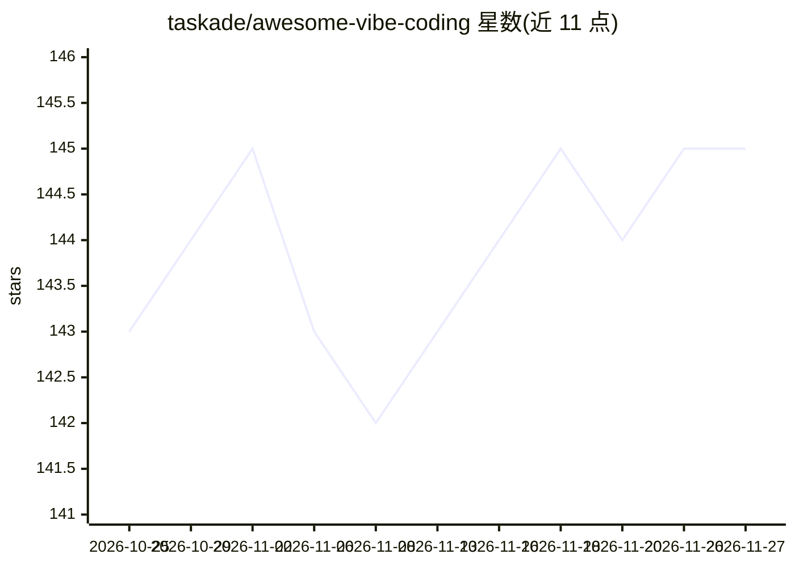

# taskade/awesome-vibe-coding

⭐ 145 · CC-BY-4.0 · 推送 2026-11-19 · [GitHub](https://github.com/taskade/awesome-vibe-coding) · [官网](https://www.taskade.com/create) · 组织维护

**Taskade 维护的 vibe coding 工具与资源策展清单（350+ 条）**

由 Taskade 维护的 awesome 清单，收录 350+ 个 vibe coding 工具与资源，按 AI App Builders、AI Code Editors、CLI & Terminal Tools、AI Agents、MCP 服务器等类别组织为表格，每条给出定价模式、适用人群与一句话说明。收录标准要求条目有可用 URL、许可证、文档及 90 天内提交记录。清单内含面向 Taskade Genesis 产品的介绍章节（Workspace DNA 架构与示例应用），并以 CC BY 4.0 发布。

## 筛选速览

| 维度 | 判定 | 备注 |
|---|---|---|
| AI 角色 | `ai-knowledge` | 知识聚合/清单类 |
| 许可风险 | `viral` | CC-BY-4.0 |
| 部署形态 | `library` | 以包/库形式分发 |
| 模型依赖 | — | README 未给出锁定关系 |
| 硬件要求 | — | 无带数字的原话,不猜 |
| 安装摩擦 | `low` | 无编译、无系统依赖或容器化 |
| 成熟度 | — | 结构信号不足 |

## 能力要点

- 350+ 工具条目，按场景分类并给出定价模式与适用人群
- 收录标准：每条需有 URL、许可证、文档与 90 天内提交
- 包含从入门概念到安全检查清单的学习路径导航
- 以 CC BY 4.0 许可发布

## 适用场景

- 想了解 vibe coding 概念并挑选合适的 AI 编程工具
- 按编辑器/终端/Agent 等使用方式查找对应工具
- 为无代码或低代码建应用需求对比可选平台

## 场景标签

`精选清单` `教程课程` · 领域:学习与行业

## 证据(README 行号)

> L5: **350+ tools and resources · Updated 2026-11-18 · CC BY 4.0**
> L11: **How to use this list.** Each section holds one or more tables. Every entry gives the pricing model, the audience 
> L13: **How to contribute.** Add one tool per pull request. Every entry needs a live URL, a license, documentation, and a

## 星数曲线

2026-10-25 143 → 2026-11-27 145（+2）

---
*卡片 v1 · prompt 1.4 · 生成 2026-11-27 · 置信度 mid · 依据 README sha `ac29b7665f99` · [字段定义](../../DATASET.md)*
