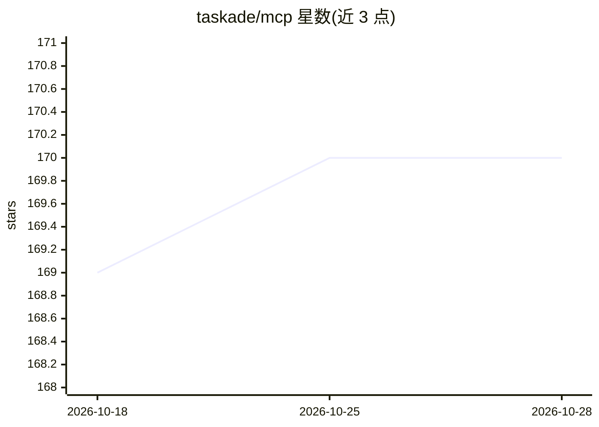

# taskade/mcp

⭐ 170 · TypeScript · MIT · 推送 2026-10-28 · [GitHub](https://github.com/taskade/mcp) · [官网](https://taskade.com/blog/mcp) · 组织维护

**Taskade 官方 MCP 服务器与 OpenAPI 转 MCP 代码生成器**

Taskade 官方仓库，含两个包：本地 stdio 服务器 @taskade/mcp-server（以 npx 运行，用个人访问令牌调用 Taskade 公共 API），以及可从任意 OpenAPI 规范生成 MCP 工具的代码生成器。另提供托管服务器（Streamable HTTP + OAuth 2.0，含 48 个工具），支持在 Claude、Cursor、VS Code、Windsurf、Cline 等 MCP 客户端中连接；本地包含 62 个工具，覆盖工作区、项目、任务、AI Agent、模板与 webhook 等操作。托管服务器 MCP 访问需付费计划，Free 计划 list_spaces 返回空。

## 筛选速览

| 维度 | 判定 | 备注 |
|---|---|---|
| AI 角色 | `ai-ecosystem` | LLM/agent 周边工具 |
| 许可风险 | `permissive` | MIT |
| 部署形态 | `library` | 以包/库形式分发 |
| 模型依赖 | — | README 未给出锁定关系 |
| 硬件要求 | — | 无带数字的原话,不猜 |
| 安装摩擦 | `low` | 无编译、无系统依赖或容器化 |
| 成熟度 | — | 结构信号不足 |

## 能力要点

- 托管服务器提供 48 个带 MCP 工具注解的工具（Streamable HTTP + OAuth 2.0）
- 本地 stdio 包含 62 个工具，映射 Taskade 公共 API v1/v2
- OpenAPI Codegen 可从任意 OpenAPI 规范生成 MCP 工具
- 本地包含 webhook 订阅与 AI Agent 对话等 API v2 beta 能力

## 适用场景

- 在 Claude/Cursor 等 MCP 客户端中直接管理 Taskade 项目与任务
- 通过对话创建和管理 Taskade AI agent
- 将自己的 OpenAPI 服务转换为 MCP 工具供 AI 客户端调用

## 场景标签

`工作流自动化` `代码生成` · 领域:效率与自动化

## 证据(README 行号)

> L3: **Connect Taskade to Claude, Cursor, VS Code, Windsurf and any other client of the Model Context Protocol.**
> L15: This repo holds two packages:
> L17: - MCP Server (`@taskade/mcp-server`): the local stdio server, for clients that cannot connect to a remote server.

## 星数曲线

2026-10-18 169 → 2026-10-28 170（+1）

---
*卡片 v1 · prompt 1.4 · 生成 2026-10-22 · 置信度 high · 依据 README sha `7099f9f48d3e` · [字段定义](../../DATASET.md)*
