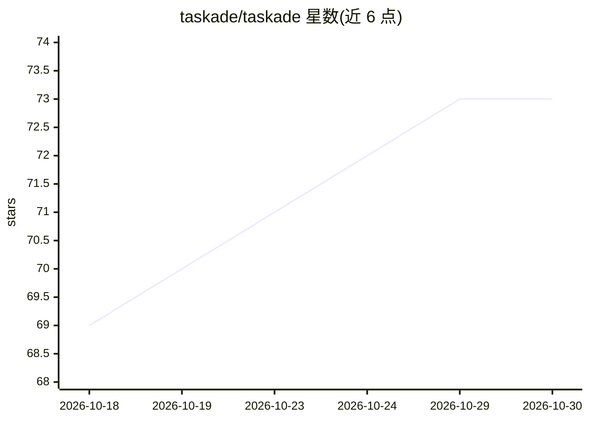

# taskade/taskade

⭐ 73 · NOASSERTION · 推送 2026-10-28 · [GitHub](https://github.com/taskade/taskade) · [官网](https://taskade.com) · 组织维护

**AI 原生工作区平台：一个提示词生成可运行应用与 AI agent**

Taskade 是公司运营的商业 SaaS 平台，本仓库托管公开文档、产品对比与可复制的 App Kits，并非产品源码。产品功能：通过自然语言提示生成带数据库、AI agent、自动化流程、登录与域名的托管应用（Taskade Genesis）；支持自定义 agent、多 agent 协作、长期记忆、100+ 集成与多视图项目管理。提供 Web、桌面、移动与浏览器端，含 REST API、MCP 服务器与 Claude Code 插件。免费档起步，付费方案另计。

## 筛选速览

| 维度 | 判定 | 备注 |
|---|---|---|
| AI 角色 | `ai-native` | 本体是模型或模型工具 |
| 许可风险 | `none` | NOASSERTION |
| 部署形态 | `library` | 以包/库形式分发 |
| 模型依赖 | — | README 未给出锁定关系 |
| 硬件要求 | — | 无带数字的原话,不猜 |
| 安装摩擦 | `low` | 无编译、无系统依赖或容器化 |
| 成熟度 | — | 结构信号不足 |

## 能力要点

- 一个提示词生成带数据库、agent 与自动化的托管应用
- 自定义 AI agent、多 agent 团队协作与长期记忆
- 工作流自动化：触发器、分支逻辑、100+ 连接器
- 提供 REST API、托管 MCP 服务器与 Claude Code 插件

## 适用场景

- 用一句提示词快速搭建 CRM、门户、表单等内部工具
- 在项目管理中部署训练于自有文档的 AI agent
- 通过自动化流程连接表单、邮件与 Slack/Stripe 等服务

## 场景标签

`工作流自动化` `AI 助手` `知识库管理` · 领域:效率与自动化

## 证据(README 行号)

> L46: **Taskade is an AI-native workspace platform that turns a single prompt into a complete, running application.** It 
> L96: |🏗️|**Taskade Genesis AI App Builder**|Turn one prompt into a live, shareable app: dashboards, CRMs, portals, forms

## 星数曲线

2026-10-18 69 → 2026-10-30 73（+4）

---
*卡片 v1 · prompt 1.4 · 生成 2026-10-24 · 置信度 mid · 依据 README sha `b04c8371b9b4` · [字段定义](../../DATASET.md)*
