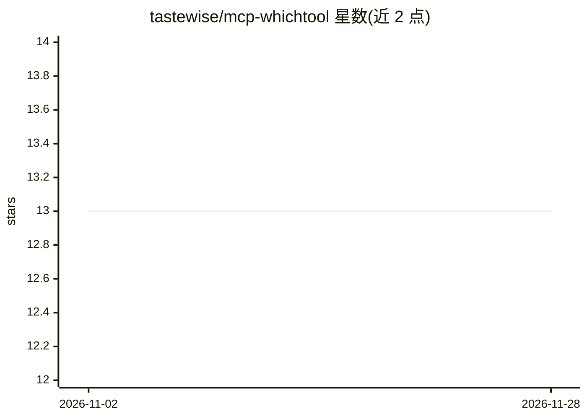

# tastewise/mcp-whichtool

⭐ 13 · TypeScript · Apache-2.0 · 推送 2026-11-15 · [GitHub](https://github.com/tastewise/mcp-whichtool) · 组织维护

**MCP 服务器工具路由评测 CLI：测模型是否选对工具**

面向 MCP 服务器开发者的工具路由测试工具：扫描 Python/TypeScript/JavaScript 源码或运行中服务器声明的工具，用模型生成测试用例（prompt→期望工具），在 Anthropic 与 OpenAI 模型上按用例多次抽取运行，报告通过/弱通过/未路由到工具的结果与花费估算；对失败用例给出 AI 描述修改建议并可本地重放验证后写回源码。可导出含 GitHub Actions workflow 的测试套件在 CI 中运行，退出码区分通过/失败/无法运行。本地运行，无官方服务端，API key 留在浏览器或 .env。

## 筛选速览

| 维度 | 判定 | 备注 |
|---|---|---|
| AI 角色 | `ai-ecosystem` | LLM/agent 周边工具 |
| 许可风险 | `permissive` | Apache-2.0 |
| 部署形态 | `library` | 以包/库形式分发 |
| 模型依赖 | locked-api |  |
| 硬件要求 | — | 无带数字的原话,不猜 |
| 安装摩擦 | `low` | 无编译、无系统依赖或容器化 |
| 成熟度 | `idea` | |

## 能力要点

- 扫描 Python/TS/JS 源码或任意语言的运行中服务器提取工具与描述
- 每用例按模型多次抽取（默认 3 次），严格多数通过判定，支持弱通过与费用预估
- Ask AI 提议描述修改并单用例重放验证，可写回 Python/TS/JS 源码
- 导出含 GitHub Actions workflow 的测试套件用于 CI

## 适用场景

- 上线前检查模型的请求是否路由到正确的 MCP 工具
- 重写模糊的工具描述并验证路由改善
- 在每次 pull request 上自动回归工具路由测试

## 场景标签

`模型评测` · 领域:评测与运维

## 证据(README 行号)

> L8: **Does the model pick the right tool?** Tool-routing tests for your MCP server: check that
> L12: user's request. mcp-whichtool runs your prompts against Claude and OpenAI models with
> L164: |`whichtool eval`|Runs the cases (`-m` model, repeatable; `-n` draws; `-k` filter on case ids; `-y` no question)|

## 星数曲线

2026-11-02 13 → 2026-11-28 13（+0）

---
*卡片 v1 · prompt 1.4 · 生成 2026-11-18 · 置信度 mid · 依据 README sha `a36409c76c8e` · [字段定义](../../DATASET.md)*
