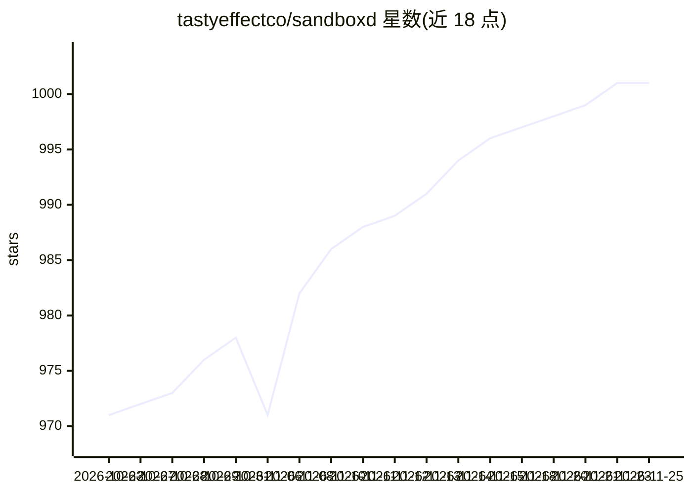

# tastyeffectco/sandboxd

⭐ 1,001 · Go · MIT · 推送 2026-11-22 · [GitHub](https://github.com/tastyeffectco/sandboxd) · [官网](https://sandboxd.io/) · 组织维护

**自托管 AI 应用构建器：agent 在沙箱中代建应用**

Go 编写的自托管平台：一个主 agent 接收自然语言任务，分派给常驻 agent（定时任务、浏览网页、Telegram 通知），或由编码 agent 在隔离容器中生成可运行应用并给出预览 URL。每个应用运行在独立加固容器中，任务可检查点回退；底层由单个 Go 程序驱动 Docker，配合 Traefik 与 SQLite。所有 /v1 HTTP 接口可复用为多租户沙箱引擎。容器隔离而非 VM、单机架构、API 认证默认关闭，README 自标 Beta 0.x。

## 筛选速览

| 维度 | 判定 | 备注 |
|---|---|---|
| AI 角色 | `ai-native` | 本体是模型或模型工具 |
| 许可风险 | `permissive` | MIT |
| 部署形态 | `self-host` | docker 或自建部署 |
| 模型依赖 | local-ok | 支持本地模型 |
| 硬件要求 | — | 无带数字的原话,不猜 |
| 安装摩擦 | `low` | 无编译、无系统依赖或容器化 |
| 成熟度 | `idea` | |

## 能力要点

- agent 在隔离沙箱中生成应用，每个应用有独立预览 URL
- 常驻 agent 支持定时任务、网页浏览与 Telegram 通知
- 沙箱内不存放凭据，由代理在线注入，任务可检查点回退
- /v1 HTTP API 可用于构建 AI 应用生成器或按用户预览环境

## 适用场景

- 用自己的服务器托管 agent，让它们定时执行监控和规划任务
- 用一句话生成带预览链接的小应用并持续对话修改
- 为自己的用户搭建按用户隔离的编码沙箱/预览环境

## 场景标签

`编码 Agent` · 领域:编码与开发

## 证据(README 行号)

> L33: **An AI crew that works for you: agents first, apps on demand.**
> L65: 3. **Apps when you need them.** A coding agent builds each app in a private
> L130: `/v1` HTTP call, so you can run many sandboxes for your own users: an AI

## 星数曲线

2026-10-23 971 → 2026-11-25 1,001（+30）

---
*卡片 v1 · prompt 1.4 · 生成 2026-11-25 · 置信度 mid · 依据 README sha `927bcd815872` · [字段定义](../../DATASET.md)*
