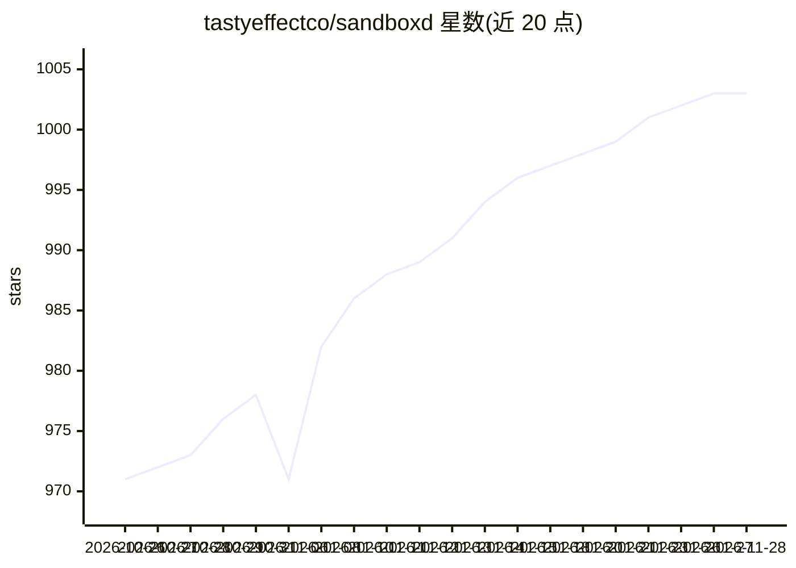

# tastyeffectco/sandboxd

⭐ 1,003 · Go · MIT · 推送 2026-11-27 · [GitHub](https://github.com/tastyeffectco/sandboxd) · [官网](https://sandboxd.io/) · 个人维护

**自托管 AI 应用构建器：agent 在沙箱中为您持续工作并构建应用**

自托管的 agent 基础设施：一个 Go 程序驱动 Docker，为每个 agent/应用提供隔离容器、独立记忆与预览 URL，空闲应用休眠按需唤醒。提供 Home 统一对话入口、定时任务、Telegram 通知、一键安装开源应用，以及由编码 agent（OpenCode、Claude Code 等）按对话生成应用的流程。控制台全部功能以 /v1 HTTP API 暴露，可用于搭建 agent 平台或按用户隔离的预览环境。MIT 许可，另有付费 Cloud 公网域名与管理服务；当前为 0.x Beta。

## 筛选速览

| 维度 | 判定 | 备注 |
|---|---|---|
| AI 角色 | `ai-ecosystem` | LLM/agent 周边工具 |
| 许可风险 | `permissive` | MIT |
| 部署形态 | `self-host` | docker 或自建部署 |
| 模型依赖 | local-ok | 支持本地模型 |
| 硬件要求 | — | 无带数字的原话,不猜 |
| 安装摩擦 | `low` | 无编译、无系统依赖或容器化 |
| 成熟度 | `idea` | |

## 能力要点

- 单 Go 程序 + Docker + Traefik + SQLite，无 Kubernetes/独立数据库/队列
- 每应用独立加固容器与实时预览 URL，任务可检查点回退
- 编码 agent 凭据经代理注入，永不进入沙箱
- 全部控制台功能即 /v1 HTTP API

## 适用场景

- 在自己的服务器上运行 agent 执行定时监控与提醒任务
- 用自然语言生成小应用并在预览 URL 中查看
- 为自己的用户搭建多沙箱 agent 平台或 coding playground

## 场景标签

`编码 Agent` `Agent 框架` · 领域:Agent 开发

## 证据(README 行号)

> L132: sandboxd is also an **engine you can build on**. Everything the console does is a
> L152: - **Coding agents:** OpenCode, Claude Code, Codex and Pi. **No credential ever
> L68: 3. **Apps when you need them.** A coding agent builds each app in a private

## 星数曲线

2026-10-26 971 → 2026-11-28 1,003（+32）

---
*卡片 v1 · prompt 1.4 · 生成 2026-11-28 · 置信度 high · 依据 README sha `dbb2dafb9853` · [字段定义](../../DATASET.md)*
