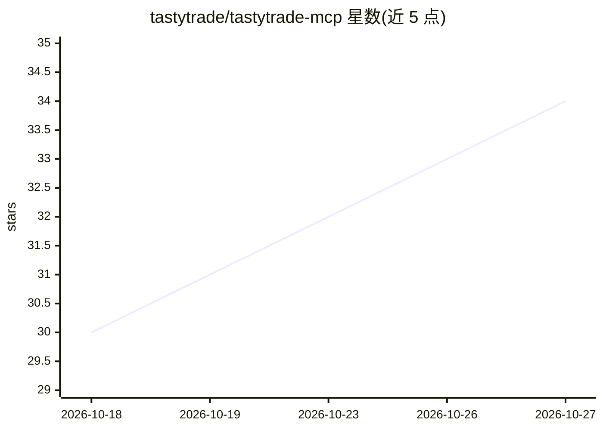

# tastytrade/tastytrade-mcp

⭐ 34 · TypeScript · NOASSERTION · 推送 2026-10-23 · [GitHub](https://github.com/tastytrade/tastytrade-mcp) · [官网](https://developer.tastytrade.com/) · 组织维护

**给 LLM agent 接入 tastytrade 券商 API 的 MCP 服务器**

基于 stdio 的 Model Context Protocol 服务器，向 LLM agent 开放 tastytrade 开放 API 的行情报价、合约与期权链、账户余额、持仓、交易记录、自选列表与订单操作（含 dry-run 门控的下单路径）。默认连接生产环境（真实账户），可通过环境变量切换 sandbox 或只读模式；三处界面（stderr 启动横幅、MCP instructions、每个订单结果的 environment 字段）声明当前环境。需 Node.js 22+ 与 tastytrade OAuth 凭据，通过 git clone 加 npm 构建安装，未发布到 npm 或容器镜像；支持 Claude Desktop、Claude Code 等 MCP 客户端。

## 筛选速览

| 维度 | 判定 | 备注 |
|---|---|---|
| AI 角色 | `ai-ecosystem` | LLM/agent 周边工具 |
| 许可风险 | `none` | NOASSERTION |
| 部署形态 | `self-host` | docker 或自建部署 |
| 模型依赖 | — | README 未给出锁定关系 |
| 硬件要求 | — | 无带数字的原话,不猜 |
| 安装摩擦 | `low` | 无编译、无系统依赖或容器化 |
| 成熟度 | — | 结构信号不足 |

## 能力要点

- 开放行情、期权链、持仓、余额与订单提交等 API 能力给 LLM agent
- 默认生产环境，提供 sandbox 切换与 READ_ONLY 只读模式（封锁 14 个写入/破坏性工具）
- 每个订单结果携带 environment 字段，交易记录可作环境证据
- 仅环境变量认证，无交互式登录流；支持订单名义金额上限等安全配置

## 适用场景

- 在 Claude Desktop / Claude Code 等 MCP 客户端中查询 tastytrade 行情与持仓
- 让 agent 在 sandbox 或只读模式下演练订单流程
- 构建需要账户余额、交易记录访问的交易类 agent 工作流

## 场景标签

`金融量化` · 领域:学习与行业

## 证据(README 行号)

> L3: A Model Context Protocol server for the
> L4: tastytrade open API, giving an LLM agent
> L5: access to quotes, instruments, option chains, balances, positions, transactions,

## 星数曲线

2026-10-18 30 → 2026-10-27 34（+4）

---
*卡片 v1 · prompt 1.4 · 生成 2026-10-25 · 置信度 mid · 依据 README sha `345a3c25081a` · [字段定义](../../DATASET.md)*
