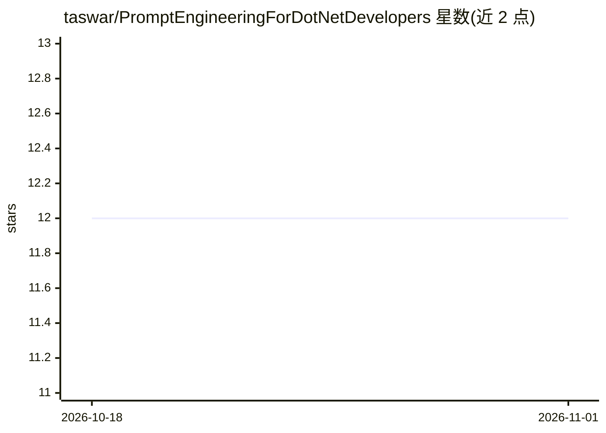

# taswar/PromptEngineeringForDotNetDevelopers

⭐ 12 · C# · NOASSERTION · 推送 2026-10-31 · [GitHub](https://github.com/taswar/PromptEngineeringForDotNetDevelopers) · [官网](https://leanpub.com/promptengineeringfornetdevelopers) · 个人维护

**面向 .NET 开发者的免费 Prompt Engineering 电子书**

免费的 Prompt Engineering 教程电子书，面向希望用 C# 和 .NET 10 构建 AI 应用的开发者。全书 7 章，每章为独立 Markdown 文件，配套可运行的 .NET 项目（src/）与单元测试（tests/），覆盖提示词结构、few-shot/CoT 等技巧、结构化输出、代码审查与测试生成等工作流。示例代码基于 Microsoft.Extensions.AI，支持 LM Studio 本地模型或 OpenAI/Azure AI Foundry API key，明确不使用 Python。全书采用 CC BY-NC 4.0 许可，可从 Leanpub 免费下载。

## 筛选速览

| 维度 | 判定 | 备注 |
|---|---|---|
| AI 角色 | `ai-knowledge` | 知识聚合/清单类 |
| 许可风险 | `none` | NOASSERTION |
| 部署形态 | `None` |  |
| 模型依赖 | — | README 未给出锁定关系 |
| 硬件要求 | — | 无带数字的原话,不猜 |
| 安装摩擦 | `medium` | 含编译或系统依赖之一 |
| 成熟度 | — | 结构信号不足 |

## 能力要点

- 7 章内容，每章含独立 Markdown、可运行项目与单元测试
- 基于 Microsoft.Extensions.AI，覆盖 OpenAI/Azure AI Foundry/LM Studio
- 全程 C#，无 Python 与 Jupyter notebook
- CC BY-NC 4.0 许可，Leanpub 可免费下载

## 适用场景

- 我想系统学习在 .NET 应用中编写生产级提示词
- 用 C# 快速上手接入本地 LM Studio 或 OpenAI 模型
- 参考各章可运行示例实现代码审查、测试生成等 AI 功能

## 场景标签

`提示工程` `教程课程` · 领域:Agent 开发

## 证据(README 行号)

> L4: > A free ebook for .NET developers who want to build real AI-powered applications — without the hype, without the Py
> L44: Each chapter is a standalone Markdown file with embedded code snippets.

## 星数曲线

2026-10-18 12 → 2026-11-01 12（+0）

---
*卡片 v1 · prompt 1.4 · 生成 2026-10-31 · 置信度 high · 依据 README sha `278d333f1b5d` · [字段定义](../../DATASET.md)*
