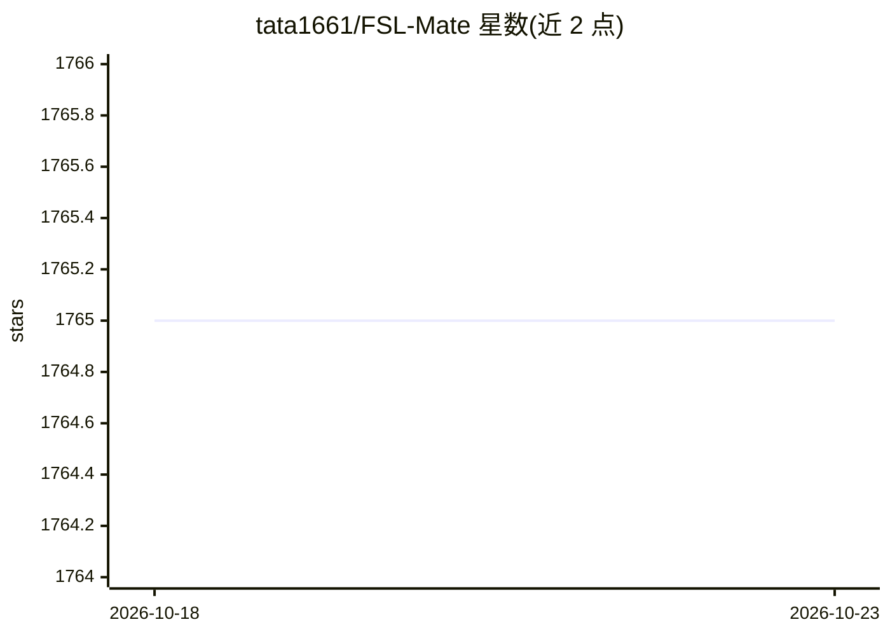

# tata1661/FSL-Mate

⭐ 1,765 · Python · 推送 2026-04-18 · [GitHub](https://github.com/tata1661/FSL-Mate) · 组织维护

**小样本学习（FSL）资源合集：论文清单与 Python 库**

面向小样本学习（Few-Shot Learning）研究者的资源集合，目前包含两部分：FewShotPapers 论文清单，跟踪 CVPR/ICML/NeurIPS/ACL/AAAI 等会议的 FSL 研究进展并持续更新；PaddleFSL，基于 PaddlePaddle 的 FSL Python 库。仓库附有团队的 FSL 综述论文引用信息（Generalizing from a few examples: A survey on few-shot learning）。

## 筛选速览

| 维度 | 判定 | 备注 |
|---|---|---|
| AI 角色 | `ai-knowledge` | 知识聚合/清单类 |
| 许可风险 | `none` | — |
| 部署形态 | `None` |  |
| 模型依赖 | — | README 未给出锁定关系 |
| 硬件要求 | — | 无带数字的原话,不猜 |
| 安装摩擦 | `low` | 无编译、无系统依赖或容器化 |
| 成熟度 | — | 结构信号不足 |

## 能力要点

- FewShotPapers：跟踪 FSL 研究进展的论文清单
- PaddleFSL：基于 PaddlePaddle 的 FSL Python 库
- 覆盖 CVPR/ICML/ACL/AAAI 等会议的 FSL 论文并持续更新

## 适用场景

- 查找小样本学习领域的论文与研究进展
- 使用 PaddleFSL 库进行 FSL 相关实验

## 场景标签

 · 领域:机器学习/小样本学习

## 证据(README 行号)

> L3: **FSL-Mate** is a collection of resources for few-shot learning (FSL).
> L7: - **FewShotPapers**: a paper list which tracks the research advances on FSL
> L8: - **PaddleFSL**: a PaddlePaddle-based python library for FSL

## 星数曲线

2026-10-18 1,765 → 2026-10-23 1,765（+0）

---
*卡片 v1 · prompt 1.4 · 生成 2026-10-21 · 置信度 high · 依据 README sha `4698a55c93c0` · [字段定义](../../DATASET.md)*
