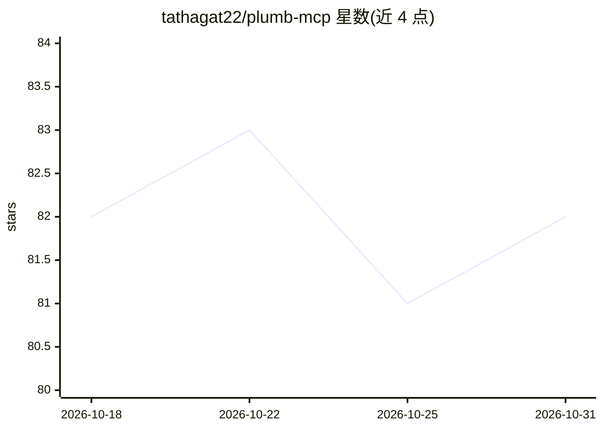

# tathagat22/plumb-mcp

⭐ 82 · TypeScript · MIT · 推送 2026-10-14 · [GitHub](https://github.com/tathagat22/plumb-mcp) · [官网](https://tathagat22.github.io/plumb-mcp/) · 个人维护

**面向编码代理的 Figma/网页→代码 MCP 服务器，含验证回路**

以单个 MCP server 形式交付的设计工程工具：通过 Figma 桌面插件读取设计文件（不走 REST、无速率限制、各付费档可用），或经 headless Chrome 读取任意网页，统一归一化为语义设计图（去重 token、flexbox 布局、角色标签），供 Claude Code、Cursor、Windsurf 等 MCP 兼容代理使用；提供 plumb_verify/plumb_fit 对交付代码与设计源做差异校验与自纠，plumb_studio 支持从一句话 brief 生成完整 Figma 页面并自我评审。共 28 个工具，npm 全局安装，需 Node 20+ 与 Figma 插件配对。

## 筛选速览

| 维度 | 判定 | 备注 |
|---|---|---|
| AI 角色 | `ai-ecosystem` | LLM/agent 周边工具 |
| 许可风险 | `permissive` | MIT |
| 部署形态 | `self-host` | docker 或自建部署 |
| 模型依赖 | — | README 未给出锁定关系 |
| 硬件要求 | — | 无带数字的原话,不猜 |
| 安装摩擦 | `low` | 无编译、无系统依赖或容器化 |
| 成熟度 | — | 结构信号不足 |

## 能力要点

- Figma 与网页两种来源归一化为同一语义设计图
- plumb_verify/plumb_fit 对代码与设计源做差异评分与修复循环
- plumb_studio 从 prompt 生成 Figma 设计并自我评审
- 插件路径绕开 REST 速率限制，免费档可用

## 适用场景

- 让 Claude Code/Cursor 从 Figma 设计稿生成并校验 React 代码
- 把现有网页导入设计系统再生成代码
- 从一句话需求生成完整 Figma 页面设计

## 场景标签

`代码生成` · 领域:编码与开发

## 证据(README 行号)

> L15: **Plumb is an AI-native design engineering platform, shipped as a single MCP server.** Point it at a Figma file *or
> L25: Built for coding agents — Claude Code, Cursor, Windsurf, anything MCP-compatible. Design engineering, agent-native:

## 星数曲线

2026-10-18 82 → 2026-10-31 82（+0）

---
*卡片 v1 · prompt 1.4 · 生成 2026-10-24 · 置信度 high · 依据 README sha `36d0e626c3e5` · [字段定义](../../DATASET.md)*
