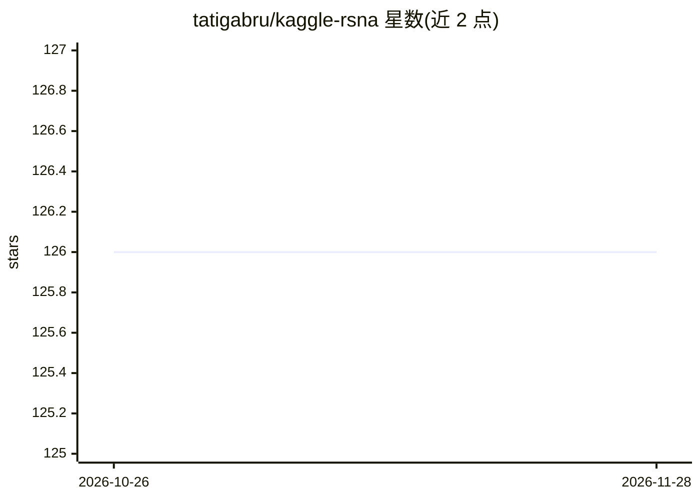

# tatigabru/kaggle-rsna

⭐ 126 · Python · MIT · 推送 2026-10-25 · [GitHub](https://github.com/tatigabru/kaggle-rsna) · [官网](https://arxiv.org/abs/2005.13899) · 个人维护

**肺炎X光检测深度学习方案：RSNA竞赛论文的代码实现**

基于单阶段检测器与SE卷积神经网络的胸部X光肺炎区域检测方案，为RSNA肺炎检测挑战赛开发，论文发表于 CVPR Workshops 2020。模型以 PyTorch 实现的 RetinaNet 为基础，测试多种 backbone，采用图像增广与多任务学习；包含 mAP 指标计算、数据下载脚本、conda/Docker 环境配置、训练与预测生成流程。需 Kaggle 账号加入竞赛获取数据集，训练在 P100 GPU 上约每 epoch 50 分钟。

## 筛选速览

| 维度 | 判定 | 备注 |
|---|---|---|
| AI 角色 | `ai-native` | 本体是模型或模型工具 |
| 许可风险 | `permissive` | MIT |
| 部署形态 | `None` |  |
| 模型依赖 | — | README 未给出锁定关系 |
| 硬件要求 | — | 无带数字的原话,不猜 |
| 安装摩擦 | `low` | 无编译、无系统依赖或容器化 |
| 成熟度 | — | 结构信号不足 |

## 能力要点

- 基于 RetinaNet（PyTorch）与 SE-ResNeXt backbone 的肺炎区域检测
- 图像预处理、增广与多任务学习训练流程
- mAP 指标计算、可视化与推理脚本完整提供
- conda 环境脚本与 Docker 两种环境配置方式

## 适用场景

- 复现 RSNA 肺炎检测挑战赛的实验结果
- 在自有胸部X光图像上生成检测结果
- 作为医学影像目标检测研究的参考实现

## 场景标签

`目标检测` · 领域:感知与多模态

## 证据(README 行号)

> L5: Pneumonia is the leading cause of death among young children and one of the top mortality causes worldwide. The pneu
> L48: The model is based on RetinaNet implementation on Pytorch with a few modifications. Several different base models' 
> L83: Once you have saved checkpoints for the trained models, you may call  ```src/train_runner.py``` with ```args.action

## 星数曲线



2026-10-26 126 → 2026-11-28 126（+0）


---
*卡片 v1 · prompt 1.4 · 生成 2026-11-28 · 置信度 high · 依据 README sha `5bbf09df7656` · [字段定义](../../DATASET.md)*
