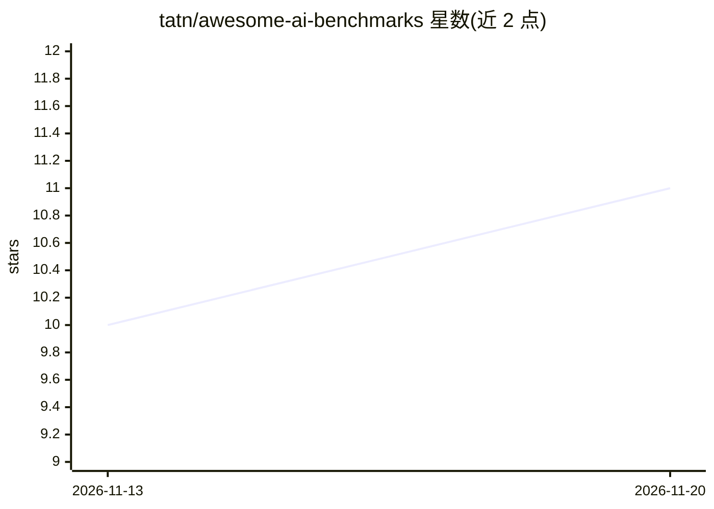

# tatn/awesome-ai-benchmarks

⭐ 11 · 推送 2026-10-06 · [GitHub](https://github.com/tatn/awesome-ai-benchmarks) · 个人维护

**面向 AI 使用者的模型基准测试与排行榜精选清单**

按类别组织的 AI 基准测试与排行榜链接清单：覆盖综合排名、用户投票排行、编程与软件开发、AI Agents、数学推理、决策模型、创意写作、网络安全、嵌入模型与语音识别等板块。每条目附简短说明。清单不提供安装或运行方式，仅作目录导航，供需要查看模型评测结果的人按领域查找对应基准或排行榜。

## 筛选速览

| 维度 | 判定 | 备注 |
|---|---|---|
| AI 角色 | `ai-knowledge` | 知识聚合/清单类 |
| 许可风险 | `none` | — |
| 部署形态 | `None` |  |
| 模型依赖 | — | README 未给出锁定关系 |
| 硬件要求 | — | 无带数字的原话,不猜 |
| 安装摩擦 | `low` | 无编译、无系统依赖或容器化 |
| 成熟度 | — | 结构信号不足 |

## 能力要点

- 按综合排名、编程、Agents、推理、创意写作等板块组织条目
- 收录用户投票类排行（LM Arena 等）与专家评审类基准
- 覆盖嵌入模型（MTEB/MMEB）与语音识别（Open ASR）排行榜

## 适用场景

- 为模型选型查找对应领域的公开基准或排行榜
- 了解编程 Agent、创意写作等方向的评测资源
- 查找嵌入模型和语音识别模型的对比榜单

## 场景标签

`模型评测` `精选清单` · 领域:评测与运维

## 证据(README 行号)

> L1: # Awesome AI Benchmark And Leaderboard
> L6: ## General Comparison & Rankings
> L23: ## Coding & Software Development

## 星数曲线

2026-11-13 10 → 2026-11-20 11（+1）

---
*卡片 v1 · prompt 1.4 · 生成 2026-11-19 · 置信度 high · 依据 README sha `33367d3d36eb` · [字段定义](../../DATASET.md)*
